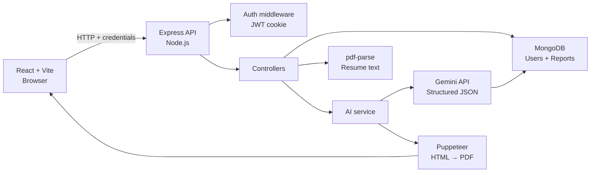
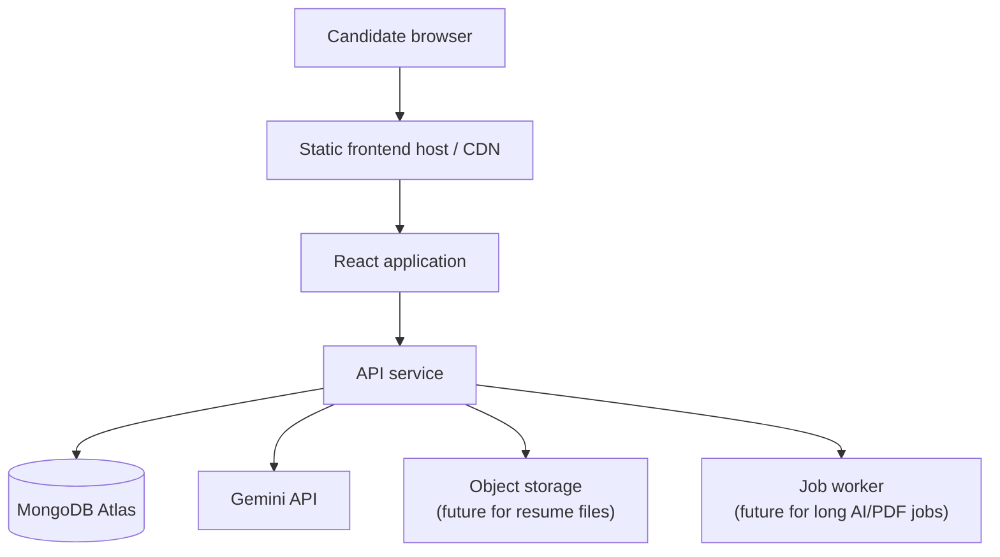
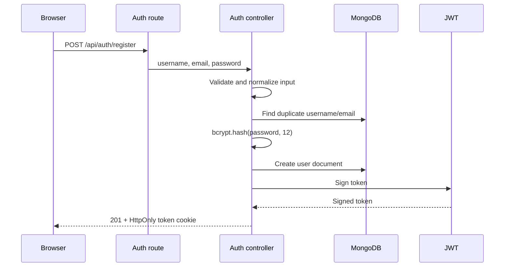
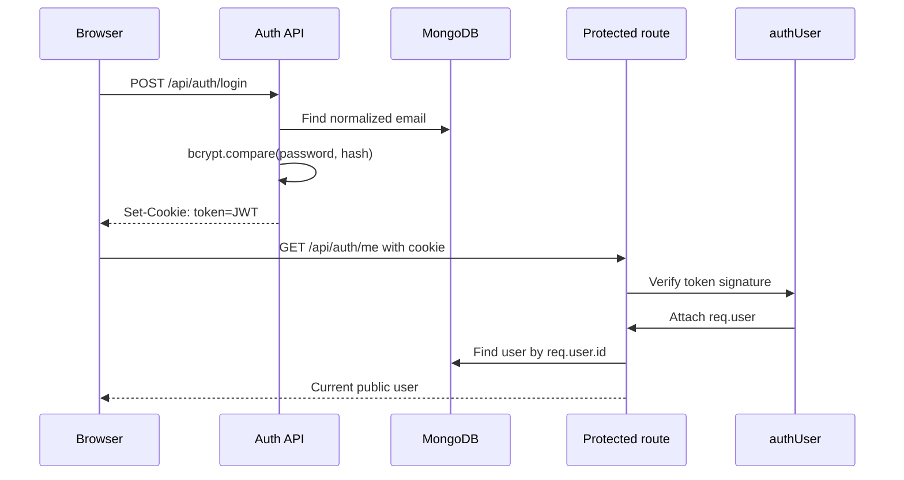
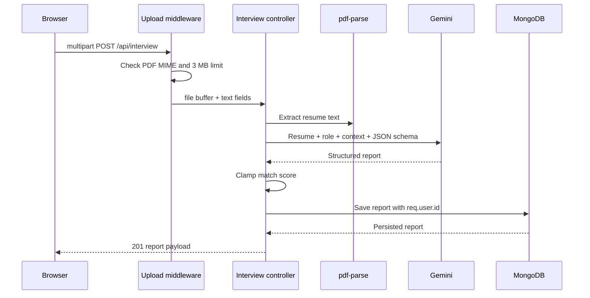
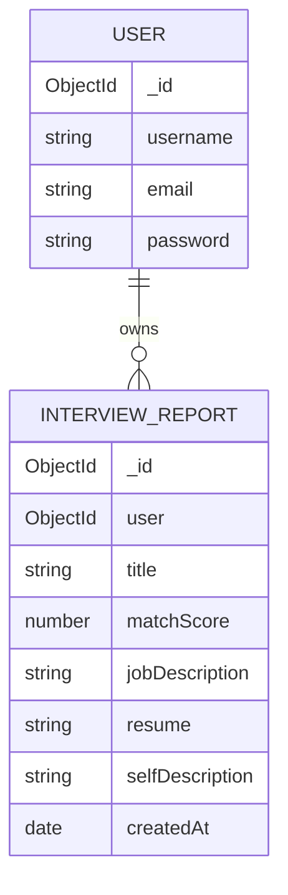
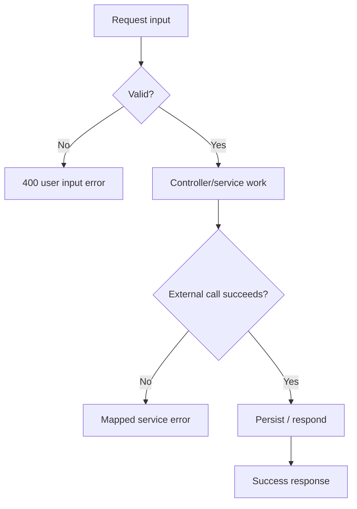
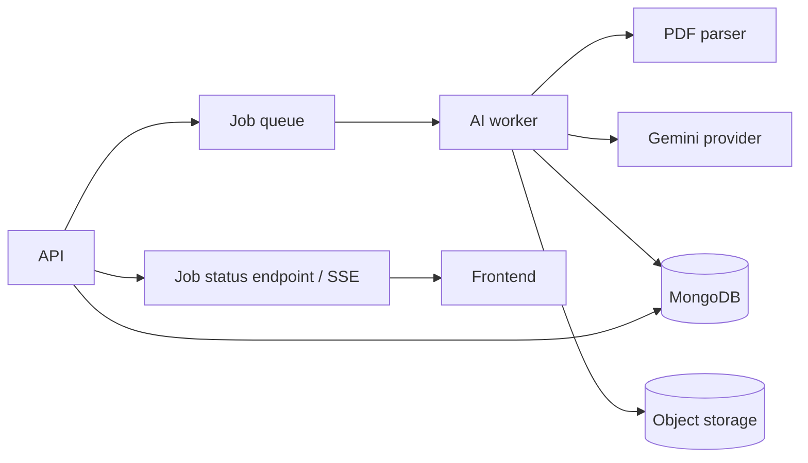

# HireLens

<p align="center">
  
  
  
  
  
</p>

<p align="center">
  <strong>Turn preparation into your unfair advantage.</strong><br />
  A full-stack, resume-aware AI workspace for role-specific interview preparation.
</p>

<p align="center">
  <a href="#quick-start">Quick start</a> ·
  <a href="#architecture-at-a-glance">Architecture</a> ·
  <a href="#api-reference">API reference</a> ·
  <a href="#interview-defense-guide">Interview guide</a>
</p>

---

## Table of contents

- [What is HireLens?](#what-is-hirelens)
- [Why this project is technically interesting](#why-this-project-is-technically-interesting)
- [Feature matrix and implementation truth](#feature-matrix-and-implementation-truth)
- [Technology stack](#technology-stack)
- [Repository structure](#repository-structure)
- [Architecture at a glance](#architecture-at-a-glance)
- [Core request lifecycles](#core-request-lifecycles)
- [Authentication and authorization](#authentication-and-authorization)
- [AI pipeline and prompt contract](#ai-pipeline-and-prompt-contract)
- [Resume processing and PDF generation](#resume-processing-and-pdf-generation)
- [Data model and persistence](#data-model-and-persistence)
- [API reference](#api-reference)
- [Environment configuration](#environment-configuration)
- [Quick start](#quick-start)
- [Frontend architecture](#frontend-architecture)
- [Design system](#design-system)
- [Error handling and observability](#error-handling-and-observability)
- [Security model](#security-model)
- [Performance and scalability](#performance-and-scalability)
- [Testing and verification](#testing-and-verification)
- [Troubleshooting](#troubleshooting)
- [System design interview guide](#system-design-interview-guide)
- [Technical interview questions](#technical-interview-questions)
- [Interview defense guide](#interview-defense-guide)
- [Roadmap](#roadmap)

---

## What is HireLens?

HireLens is a MERN-style career preparation platform that combines:

1. A candidate's resume context.
2. A target job description.
3. Optional candidate goals or self-description.
4. A structured Generative AI analysis.

The result is a persistent preparation report containing:

- A bounded role-match score.
- Technical questions with intent and model answers.
- Behavioral questions with intent and model answers.
- Skill gaps classified by severity.
- A day-wise preparation plan.

The product principle is simple:

> **The candidate and the role are the source of truth; the model is the reasoning layer.**

HireLens deliberately does not claim that an AI score guarantees an interview or bypasses an ATS. It is a preparation and feedback tool, not a hiring decision engine.

### Product workflow

```text
Create account
    ↓
Authenticate with an HTTP-only JWT cookie
    ↓
Upload a PDF resume and enter the target role
    ↓
Extract readable resume text in the backend
    ↓
Send resume + role + optional context to Gemini
    ↓
Parse a schema-constrained JSON report
    ↓
Persist the report against the authenticated user
    ↓
Render match signal, gaps, questions and preparation plan
    ↓
Generate an ATS-oriented PDF when requested
```

---

## Why this project is technically interesting

HireLens is small enough to understand end-to-end but rich enough to discuss real engineering trade-offs:

- **Authentication:** password hashing, JWT signing, cookies, CORS and protected routes.
- **Document ingestion:** multipart upload, MIME validation, memory limits and PDF parsing.
- **AI reliability:** structured output, prompt boundaries, model availability and provider errors.
- **Data modeling:** nested report data and user ownership constraints.
- **Document generation:** AI-generated HTML rendered to a PDF using a headless browser.
- **Frontend state:** loading, empty, error, success and navigation states.
- **System design:** synchronous MVP versus queues, object storage, caching and rate limiting.

This repository is also designed to be defendable in an interview: every major feature can be traced from browser event to controller, service, database write and response.

---

## Feature matrix and implementation truth

| Capability | Status | Current implementation |
|---|---:|---|
| Premium landing page | ✅ | React/Vite dark-first responsive interface |
| Registration | ✅ | Input checks, bcrypt hashing, JWT cookie |
| Login/logout | ✅ | Cookie-based session lifecycle |
| Current-user session | ✅ | Protected `/api/auth/me` |
| PDF resume upload | ✅ | Multer memory storage, PDF MIME check, 3 MB limit |
| PDF text extraction | ✅ | `pdf-parse` |
| Gemini report generation | ✅ | `@google/genai`, schema-shaped JSON response |
| Match score | ✅ | AI-generated and clamped to 0–100 |
| Skill-gap analysis | ✅ | Nested report data with low/medium/high severity |
| Technical questions | ✅ | Question, intention and answer |
| Behavioral questions | ✅ | Question, intention and answer |
| Preparation plan | ✅ | Day, focus and tasks |
| Report persistence | ✅ | MongoDB with authenticated user ownership |
| AI resume HTML | ✅ | Generated by Gemini for PDF rendering |
| Resume PDF export | ✅ | Puppeteer |
| DOCX upload | ❌ | PDF only in the current implementation |
| Dedicated deterministic ATS engine | ❌ | Current optimization is AI/prompt based |
| Live conversational interview | ❌ | Planned |
| Streaming AI output | ❌ | Current API waits for a complete report |
| Background job queue | ❌ | Synchronous MVP workflow |
| Automated integration test suite | ⚠️ | Syntax, build and smoke checks; expansion planned |

Honest status is a feature: documentation should describe what exists, not what a roadmap promises.

---

## Technology stack

### Frontend

| Technology | Why it is used |
|---|---|
| React 19 | Component-based UI and local state |
| Vite 6 | Fast development server and Node 20 compatibility |
| React Router | Client-side route composition |
| Axios | API client with `withCredentials: true` |
| CSS | Custom design tokens and responsive premium UI |

### Backend

| Technology | Why it is used |
|---|---|
| Node.js | JavaScript runtime |
| Express 5 | HTTP server, middleware and routing |
| Mongoose | MongoDB schemas, validation and queries |
| MongoDB | Persistent users and interview reports |
| bcryptjs | One-way password hashing |
| jsonwebtoken | Signed stateless session tokens |
| cookie-parser | Reading cookies from requests |
| cors | Controlled frontend/backend origin access |
| Multer | Multipart PDF upload handling |
| pdf-parse | PDF text extraction |
| `@google/genai` | Gemini API integration |
| Puppeteer | HTML-to-PDF rendering |
| dotenv | Local environment loading |

### Current AI model

The local configuration uses:

```env
GEMINI_MODEL=gemini-flash-lite-latest
```

The model is configurable through the environment rather than hard-coded into a deployment. Model availability and quotas can change by account, region and date; always verify the configured model with the provider before deployment.

---

## Repository structure

```text
HireLens/
├── server.js                         # Environment validation, DB startup, HTTP listener
├── package.json                      # Backend scripts and dependencies
├── package-lock.json
├── .env.example                      # Safe configuration template
├── .gitignore                        # Keeps .env and dependencies private
├── README.md
├── src/
│   ├── app.js                        # Express composition and middleware order
│   ├── config/
│   │   └── database.js               # Mongoose connection
│   ├── controllers/
│   │   ├── auth.controllers.js       # Register, login, logout, current user
│   │   └── interview.controllers.js  # Upload, AI report, retrieval, PDF
│   ├── middlewares/
│   │   ├── auth.middleware.js        # JWT cookie verification
│   │   └── file.middleware.js        # PDF upload policy
│   ├── models/
│   │   ├── user.model.js
│   │   └── interviewReport.model.js
│   ├── routes/
│   │   ├── auth.routes.js
│   │   └── interview.routes.js
│   └── services/
│       └── ai.service.js             # Gemini and Puppeteer integration
└── frontend/
    ├── index.html
    ├── package.json
    └── src/
        ├── main.jsx                  # Routes, pages, API integration
        └── styles.css                # Design system and responsive UI
```

### Backend layering

```text
Route
  → Middleware
    → Controller
      → Model / Service
        → External system or database
```

Controllers own HTTP concerns. Services own external integrations. Models own persistence shape. This avoids placing Gemini calls, database queries and response formatting in one route file.

---

## Architecture at a glance

### Logical architecture



### Deployment topology



The current local MVP does not require the future storage or worker nodes. They are the natural production evolution for large files, long-running inference and retryable jobs.

### Trust boundaries

```text
Untrusted browser input
        |
        | validation, origin policy, upload limits
        v
Express API boundary
        |
        | authenticated user identity
        v
Database / AI provider / PDF renderer
```

The browser is never trusted to provide a user id. Ownership is derived from the verified JWT and applied to every report query.

---

## Core request lifecycles

### Registration



### Login and protected request



### Resume-to-report flow



### PDF export flow

```text
Authenticated request
  → Load report using both report id and req.user.id
  → Send report context to Gemini
  → Receive safe HTML string
  → Launch Puppeteer
  → Set page content
  → Render A4 PDF
  → Close browser in finally
  → Stream application/pdf response
```

---

## Authentication and authorization

### Authentication

Passwords are never stored directly. Registration performs:

```js
const hashedPassword = await bcrypt.hash(password, 12);
```

Login performs:

```js
await bcrypt.compare(plainTextPassword, storedHash);
```

After successful login, the server signs a JWT containing a minimal identity payload:

```text
{
  id: user._id,
  username: user.username
}
```

The JWT is placed in a cookie named `token`:

| Cookie attribute | Development behavior |
|---|---|
| `httpOnly` | `true` |
| `sameSite` | `lax` |
| `secure` | `false` locally, `true` in production |
| `maxAge` | 24 hours |

### Authorization

The `authUser` middleware:

1. Reads `req.cookies.token`.
2. Rejects a missing cookie with `401`.
3. Verifies the token using `JWT_SECRET`.
4. Attaches the decoded user identity to `req.user`.
5. Calls `next()` only when verification succeeds.

Every report lookup uses authenticated ownership:

```js
{
  _id: req.params.interviewId,
  user: req.user.id
}
```

This prevents an authenticated user from reading another user's report by changing an id in the URL.

### Authentication versus authorization

- **Authentication:** Who is this user? JWT verification answers this.
- **Authorization:** Is this user allowed to access this resource? The `user` filter answers this.

Having a valid JWT alone is not enough; the database query must still scope the resource to the authenticated user.

---

## AI pipeline and prompt contract

### Inputs

The report request combines:

- Extracted PDF resume text, when a file is provided.
- `selfDescription`, optional candidate context.
- `jobDescription`, required target-role context.

### Prompt contract

The service instructs Gemini to:

- Act as a senior technical interview mentor.
- Compare candidate context to the target role.
- Return only valid JSON.
- Follow the supplied response schema.
- Avoid inventing candidate experience.
- Identify gaps explicitly.

### Response shape

```json
{
  "title": "Software Development Engineer preparation",
  "matchScore": 78,
  "technicalQuestions": [
    {
      "question": "Explain how you would design...",
      "intention": "Tests system design reasoning",
      "answer": "A strong answer should..."
    }
  ],
  "behavioralQuestions": [
    {
      "question": "Tell me about a difficult trade-off...",
      "intention": "Tests ownership and communication",
      "answer": "Use a specific STAR example..."
    }
  ],
  "skillGaps": [
    {
      "skill": "Distributed systems",
      "severity": "medium"
    }
  ],
  "preparationPlan": [
    {
      "day": 1,
      "focus": "Role fundamentals",
      "tasks": ["Review REST design", "Practice one system-design prompt"]
    }
  ]
}
```

### Why structured output matters

Without a schema, the model may return headings, Markdown, prose or missing fields. Structured output makes the contract explicit and reduces rendering ambiguity. The backend still parses the returned text and treats parse failure as an error; schema constraints are not a substitute for validation.

### AI reliability boundaries

The AI provider can:

- Rate-limit or temporarily return `503`.
- Deprecate a model.
- Return malformed content.
- Produce a low-quality or incomplete analysis.

The application therefore:

- Makes the model configurable.
- Clamps `matchScore` to `0..100`.
- Converts invalid JSON into a `502`-style service error.
- Does not silently fabricate a successful report.
- Keeps API keys server-side.

---

## Resume processing and PDF generation

### Upload policy

The current upload middleware accepts:

- One file field: `resume`.
- PDF MIME type only.
- Maximum size: 3 MB.
- In-memory storage.

Memory storage is appropriate for the current small-file MVP because the PDF is immediately parsed and is not stored as a binary file. It is not ideal for large files or high concurrency.

### Production evolution

For production-scale uploads:

1. Validate extension, MIME and file signature.
2. Upload directly to object storage using a signed URL.
3. Store metadata and object key, not raw files in MongoDB.
4. Queue extraction and AI analysis.
5. Delete temporary files after processing.
6. Encrypt objects at rest and restrict access by user ownership.

### Puppeteer security boundary

AI-generated HTML is rendered by a headless browser. The service should keep generated HTML constrained:

- No scripts.
- No remote resources unless explicitly allowed.
- No user-controlled navigation.
- Short browser lifetime.
- Always close the browser in `finally`.

The current implementation generates an ATS-oriented HTML resume and renders it to A4 PDF. It is not yet a full deterministic resume template engine.

---

## Data model and persistence

### User document

The user model stores the account identity and password hash:

```text
User
├── username
├── email
└── password (bcrypt hash)
```

The password should never be returned in public responses. The controllers project only:

```text
id, username, email
```

### InterviewReport document

```text
InterviewReport
├── user                 → users._id
├── title
├── jobDescription
├── resume
├── selfDescription
├── matchScore           0..100
├── technicalQuestions[]
│   ├── question
│   ├── intention
│   └── answer
├── behavioralQuestions[]
│   ├── question
│   ├── intention
│   └── answer
├── skillGaps[]
│   ├── skill
│   └── severity         low | medium | high
├── preparationPlan[]
│   ├── day
│   ├── focus
│   └── tasks[]
├── createdAt
└── updatedAt
```

The `user` field is indexed because the dominant access pattern is “list this user's reports” and “load this user's report by id.”

### Relationship



### Data retention considerations

Resume text and job descriptions can contain personal or confidential information. A production version should define:

- Retention period.
- User deletion behavior.
- Export and deletion endpoints.
- Encryption and access logging.
- Whether provider prompts are retained by the AI vendor.

---

## API reference

Base URL:

```text
http://localhost:3000
```

All JSON responses use a `message` field for user-readable errors where applicable.

### Health/root endpoint

```http
GET /
```

Response:

```text
HireLens API is running
```

### Register

```http
POST /api/auth/register
Content-Type: application/json
```

Body:

```json
{
  "username": "Sonam Narula",
  "email": "sonam@example.com",
  "password": "Test12345"
}
```

Success: `201 Created`, sets `token` cookie.

### Login

```http
POST /api/auth/login
Content-Type: application/json
```

Body:

```json
{
  "email": "sonam@example.com",
  "password": "Test12345"
}
```

Success: `200 OK`, sets `token` cookie.

### Logout

```http
POST /api/auth/logout
```

Clears the `token` cookie.

### Current user

```http
GET /api/auth/me
Cookie: token=<jwt>
```

Success: `200 OK`.

### Generate interview report

```http
POST /api/interview
Content-Type: multipart/form-data
Cookie: token=<jwt>
```

Fields:

| Field | Required | Description |
|---|---:|---|
| `resume` | One of resume/context | PDF file, max 3 MB |
| `jobDescription` | Yes | Target role requirements |
| `selfDescription` | One of resume/context | Optional candidate context |

At least one of `resume` or non-empty `selfDescription` is required.

Success: `201 Created`.

### List reports

```http
GET /api/interview
Cookie: token=<jwt>
```

Returns the current user's reports without the large resume and job-description fields.

### Get one report

```http
GET /api/interview/report/:interviewId
Cookie: token=<jwt>
```

The user ownership filter is applied server-side.

### Generate resume PDF

```http
POST /api/interview/resume/pdf/:interviewReportId
Cookie: token=<jwt>
```

Success:

```text
Content-Type: application/pdf
Content-Disposition: attachment
```

### Status code semantics

| Status | Meaning |
|---:|---|
| `200` | Successful read/action |
| `201` | Resource created |
| `400` | Invalid or incomplete input |
| `401` | Missing/invalid authentication |
| `404` | Resource does not exist for this user |
| `409` | Duplicate account conflict |
| `502` | Upstream AI returned unusable output |
| `503` | Required service configuration or provider unavailable |
| `500` | Unexpected server failure |

---

## Environment configuration

Create a root `.env` file. Never commit it.

```env
MONGO_URI=mongodb+srv://<user>:<password>@<cluster>/<database>
JWT_SECRET=replace-with-a-long-random-secret
GOOGLE_GENAI_API_KEY=replace-with-your-private-key
GEMINI_MODEL=gemini-flash-lite-latest
FRONTEND_URL=http://localhost:5173
PORT=3000
```

### Variable reference

| Variable | Required | Purpose |
|---|---:|---|
| `MONGO_URI` | Yes | MongoDB connection string |
| `JWT_SECRET` | Yes | JWT signing and verification |
| `GOOGLE_GENAI_API_KEY` | Yes for AI | Server-side Gemini credential |
| `GEMINI_MODEL` | No | Configurable Gemini model |
| `FRONTEND_URL` | No | Primary allowed frontend origin |
| `PORT` | No | Defaults to `3000` |

The server validates required configuration before connecting and listening. Missing credentials should fail at startup rather than during a user request.

### Secret safety

Do not:

- Paste API keys into chat, screenshots or issues.
- Put secrets in `frontend/.env` if the browser can bundle them.
- Commit `.env`.
- Log full tokens or provider keys.
- Use `git add -f .env`.

If a key is exposed, revoke it and generate a replacement.

---

## Quick start

### Prerequisites

- Node.js 20 or newer.
- npm.
- MongoDB Atlas or local MongoDB.
- Gemini API key for AI analysis.

### Backend

```bash
cd /Users/sonamnarula/Desktop/HireLens
npm install
cp .env.example .env
# Edit .env with your own values
npm run dev
```

Expected:

```text
MongoDB Connected: <host>
Server is running on port 3000
```

### Frontend

Open a second terminal:

```bash
cd /Users/sonamnarula/Desktop/HireLens/frontend
npm install
npm run dev
```

Open:

```text
http://localhost:5173
```

The frontend also works at `http://127.0.0.1:5173`; the backend allows both local development origins.

### Smoke test

```bash
curl http://localhost:3000/
```

Register:

```bash
curl -i -c /tmp/hirelens-cookies.txt \
  -X POST http://localhost:3000/api/auth/register \
  -H "Content-Type: application/json" \
  -d '{"username":"demo","email":"demo@example.com","password":"Test12345"}'
```

Check session:

```bash
curl -i -b /tmp/hirelens-cookies.txt \
  http://localhost:3000/api/auth/me
```

### Scripts

Backend:

```bash
npm run dev
npm test
```

Frontend:

```bash
npm run dev
npm run build
npm run preview
```

---

## Frontend architecture

The frontend is intentionally compact and currently composed from `frontend/src/main.jsx` and `frontend/src/styles.css`.

### Route map

| Route | Surface | Access |
|---|---|---|
| `/` | Landing page | Public |
| `/login` | Login | Public |
| `/register` | Registration | Public |
| `/dashboard` | Workspace overview | Protected |
| `/resume` | Resume lab and AI analysis | Protected |
| `/match` | Match-score workspace | Protected |
| `/interview` | Interview preparation entry | Protected |
| `/interview/:id` | Generated report | Protected |
| `/settings` | Profile/settings surface | Protected |

### Auth guard behavior

On protected routes, `AuthGuard` calls `/api/auth/me`. If the request fails, the user is redirected to `/login`. Axios is configured with:

```js
withCredentials: true
```

This is necessary because the session is carried in a cookie rather than a browser-managed authorization header.

### UI state model

Every important operation should have:

```text
idle → loading → success
             ↘ error
```

The resume lab exposes:

- Missing-input validation.
- Selected-file state.
- Disabled/loading action button.
- API error message.
- Navigation to the generated report.

### Current frontend improvement opportunities

- Add a global toast system.
- Add report list state to the dashboard.
- Add retry/backoff messaging for temporary AI outages.
- Add an AbortController timeout for long AI requests.
- Split the large page module into feature folders.
- Add accessible labels and automated accessibility checks.

---

## Design system

HireLens uses a dark-first visual system intended to feel closer to a focused professional workspace than a tutorial dashboard.

### Design principles

- Deep charcoal surfaces instead of pure black.
- Lime accent reserved for primary action and progress signal.
- Quiet borders and restrained shadows.
- Generous whitespace and clear hierarchy.
- Real iconography rather than emoji UI controls.
- Responsive navigation and compact mobile behavior.
- Empty states that explain the next action.

### Component vocabulary

```text
Button
Input / Textarea
Card / Panel
Status pill
Empty state
Upload zone
Sidebar navigation
Score visualization
Question block
Preparation-plan item
```

The next design-system step is extracting these primitives into reusable React components with typed variants and centralized tokens.

---

## Error handling and observability

### Error flow



The backend has a final Express error middleware. Known service failures should retain meaningful status codes; unexpected errors should not leak stack traces to the browser.

### Current observability

- Startup logs MongoDB connection host and server port.
- Request failures are logged server-side.
- Browser receives a safe message.
- Secrets are not intended to be logged.

### Production observability plan

- Correlation/request id.
- Structured JSON logs.
- Request duration and status metrics.
- AI latency, token usage and provider status metrics.
- Error tracking with redacted payloads.
- Alerts for repeated provider failures.

---

## Security model

### Implemented protections

- bcrypt password hashing.
- HTTP-only authentication cookie.
- JWT signature verification.
- Protected routes.
- User-scoped report queries.
- CORS allowlist for local frontend origins.
- PDF-only upload policy.
- 3 MB upload limit.
- Generic unexpected-error responses.
- Environment secrets outside source control.

### Threat model

| Threat | Mitigation |
|---|---|
| Password database leak | bcrypt hash, never plaintext |
| Token access from ordinary JS | HTTP-only cookie |
| Cross-origin credential abuse | CORS allowlist |
| Report ID enumeration | User ownership in every query |
| Oversized upload | Multer file-size limit |
| Unsupported upload type | PDF MIME policy |
| Prompt data leakage | Keep provider key server-side; document retention policy |
| HTML/Puppeteer abuse | Constrain generated HTML; no scripts/resources |
| Brute-force login | Rate limiting still required |
| CSRF | SameSite helps locally; add CSRF strategy for cross-site production |

### Production security backlog

- Rate limit login and AI endpoints.
- Add helmet/security headers.
- Add request-body size limits.
- Validate PDF magic bytes, not only MIME.
- Encrypt sensitive persisted text where required.
- Add account deletion and data export.
- Add refresh-token rotation or short-lived access-token strategy.
- Add CSRF protection if cookie behavior requires cross-site requests.
- Redact resume text from logs and traces.

---

## Performance and scalability

### Current MVP characteristics

The report endpoint is synchronous:

```text
upload → parse → Gemini request → MongoDB write → response
```

This is easy to understand and works well for small demos, but the request remains open while AI and parsing complete.

### Scaling bottlenecks

1. PDF parsing consumes server memory.
2. Gemini latency keeps an HTTP request open.
3. Puppeteer launches a browser process.
4. Large resume text increases prompt size and cost.
5. Concurrent requests can exhaust provider quota.

### Production architecture



The API would return `202 Accepted` with a job id. The frontend would poll or subscribe to status updates. Workers could retry transient provider failures with exponential backoff and a dead-letter queue.

### Cost and latency controls

- Truncate or summarize very large resumes.
- Cache identical normalized inputs.
- Use a cheaper flash model for first-pass analysis.
- Limit report question counts.
- Add per-user quotas.
- Queue PDF generation.
- Avoid sending binary PDFs directly to the AI provider when text extraction is enough.

---

## Testing and verification

### Current checks

Backend syntax:

```bash
npm test
```

Frontend production build:

```bash
cd frontend
npm run build
```

Manual smoke path:

```text
Register → Login → /api/auth/me → Upload PDF → Analyze → Read report
```

### Recommended automated test pyramid

#### Unit tests

- Password validation.
- Email normalization.
- Score clamping.
- Report-shape validation.
- Upload policy.
- Prompt construction.

#### Integration tests

- Register and duplicate conflict.
- Login invalid credentials.
- Cookie-protected `/api/auth/me`.
- Unauthenticated report rejection.
- Cross-user report access rejection.
- Report persistence.

#### Contract tests

- Gemini response parsing.
- PDF extraction output.
- PDF response headers.

#### End-to-end tests

- Browser registration and login.
- Resume upload.
- Loading and error states.
- Report navigation.

### Test cases to defend in an interview

| Case | Expected |
|---|---|
| Password shorter than 8 chars | `400` |
| Existing email/username | `409` |
| Wrong login password | `401` |
| Missing token | `401` |
| Invalid token | `401` |
| Missing job description | `400` |
| No resume and no self-description | `400` |
| Non-PDF upload | Rejected |
| File over 3 MB | Rejected |
| AI provider unavailable | Service error, no fake report |
| Report owned by another user | `404` |

---

## Troubleshooting

### `nodemon: command not found`

From the project root:

```bash
npm install
npm run dev
```

### `app.listen is not a function`

Check that the Express app is exported with:

```js
module.exports = app;
```

not `module.export`.

### `JWT_SECRET is not configured`

Add `JWT_SECRET` to the root `.env`, then fully restart the backend. Do not put it in the frontend.

### `GOOGLE_GENAI_API_KEY is not configured`

Add the key to the root `.env`, never to browser code, then restart Node. Verify without printing the secret:

```bash
grep -q '^GOOGLE_GENAI_API_KEY=.' .env \
  && echo "Gemini key configured" \
  || echo "Gemini key missing"
```

### Gemini model not found or unavailable

Check the model configured in `.env`:

```bash
grep '^GEMINI_MODEL=' .env
```

Model names and availability can change. List models using the provider SDK or select an available model in Google AI Studio. Restart the backend after changing `.env`.

### `Internal server error` during analysis

The browser message is intentionally generic. Read the backend terminal's latest error. Common causes:

- Provider model unavailable.
- Provider quota/rate limit.
- Invalid API key.
- Malformed model JSON.
- MongoDB write failure.
- PDF parser failure.

Do not share the API key when sharing logs.

### `Unable to connect`

Check both processes:

```bash
lsof -nP -iTCP:3000 -sTCP:LISTEN
curl http://localhost:3000/
```

Use the same host consistently:

```text
Frontend: http://localhost:5173
Backend:  http://localhost:3000
```

The current development CORS policy supports both `localhost` and `127.0.0.1`.

### Multiple backend processes

Multiple nodemon instances can make debugging confusing. Stop duplicate HireLens terminals with `Control + C`, then start one backend:

```bash
cd /Users/sonamnarula/Desktop/HireLens
npm run dev
```

Never kill unrelated applications by process name.

### Puppeteer fails

Chromium may need deployment-specific dependencies. Keep Puppeteer browser lifecycle inside `try/finally`, and use a container/runtime that supports headless Chromium.

---

## System design interview guide

### 1. Design a production version of HireLens

**Start with requirements:**

- Candidate registers and authenticates.
- Candidate uploads a resume.
- Candidate adds a target job.
- System produces a structured report.
- Candidate can revisit reports and export a PDF.

**Non-functional requirements:**

- Private user data.
- Predictable latency for normal requests.
- Retryable AI failures.
- Quotas and abuse protection.
- Horizontal scalability.
- Observability and auditability.

**First architecture:**

```text
React → API gateway/load balancer → stateless API
                                      ├── MongoDB
                                      ├── object storage
                                      ├── queue
                                      └── AI workers
```

**Why asynchronous processing?**

AI calls and PDF rendering can take seconds or fail transiently. A queue prevents the API request from being held open and lets workers retry safely.

### 2. How would you scale from 100 to 1 million users?

1. Keep API instances stateless.
2. Store files in object storage, not process memory.
3. Add a queue for parsing and AI jobs.
4. Add MongoDB indexes on `user`, `createdAt` and job status.
5. Add quotas per user and per IP.
6. Cache normalized repeated analysis only where privacy policy permits.
7. Separate report reads from AI writes.
8. Add worker autoscaling based on queue depth.
9. Add CDN delivery for frontend assets.
10. Use provider fallbacks only with an explicit data policy.

### 3. How do you prevent unauthorized report access?

Never trust a report id alone. After verifying the JWT:

```js
findOne({
  _id: requestedReportId,
  user: req.user.id
})
```

If no matching document exists, return `404`. This avoids confirming whether another user's report id exists.

### 4. How would you handle AI outages?

- Return a clear retryable error.
- Classify provider errors into invalid request, quota, unavailable and timeout.
- Retry only transient categories.
- Use exponential backoff with jitter in workers.
- Persist job status (`queued`, `processing`, `completed`, `failed`).
- Never create a fake success report.
- Show the user whether retrying is safe.

### 5. How would you improve AI quality?

- Use a versioned prompt template.
- Use structured output and schema validation.
- Normalize resume text before prompting.
- Keep candidate evidence separate from inferred recommendations.
- Ask for citations to resume sections in a future schema.
- Evaluate on a fixed benchmark of anonymized resumes and roles.
- Track hallucination, completeness and consistency metrics.

### 6. How would you design a deterministic ATS score?

Do not rely only on an LLM. Build a hybrid:

```text
Parse resume
  → normalize terms and synonyms
  → extract job skills and constraints
  → compute keyword/semantic coverage
  → check section/readability rules
  → combine weighted signals
  → ask LLM for explanation, not the numeric truth
```

This makes the score reproducible and keeps the model focused on explanations and suggestions.

### 7. What would you cache?

Potential cache keys:

```text
hash(normalized_resume + normalized_job + prompt_version + model)
```

Cache only if:

- The user has permission to reuse the result.
- Sensitive data handling is documented.
- The result is versioned.
- Invalidations happen when prompts/models change.

### 8. How do you protect the AI endpoint?

- Authentication.
- Per-user request quotas.
- IP rate limiting.
- Maximum file and text sizes.
- Request timeout.
- Queue concurrency limits.
- Provider budget alerts.
- Redacted logs.

---

## Technical interview questions

Use these questions to practice defending the actual codebase.

### JavaScript and Node.js

1. Why does `require("dotenv").config()` need to run before importing modules that read environment variables?
2. What is the difference between synchronous and asynchronous Node.js work in the report request?
3. Why is `finally` important around Puppeteer cleanup?
4. What happens when an async Express controller throws?
5. Why should a CPU-heavy PDF operation move to a worker at scale?

### Express

1. What is the middleware order in `src/app.js`?
2. Why must `express.json()` run before JSON route handlers?
3. How does CORS differ from authentication?
4. Why is the final error middleware placed after routes?
5. How would you add request ids?

### MongoDB and Mongoose

1. Why is `InterviewReport.user` indexed?
2. Why embed questions inside a report instead of creating separate collections?
3. What are the trade-offs of storing extracted resume text in MongoDB?
4. How would you paginate a user's reports?
5. How would you implement account deletion?

### Authentication

1. Why bcrypt instead of encryption?
2. Why is an HTTP-only cookie safer than localStorage for a token?
3. What happens when the JWT expires?
4. What is the difference between token verification and resource authorization?
5. What changes are required for production cookie settings?

### AI and LLMs

1. Why is structured output necessary?
2. What happens if the model returns invalid JSON?
3. How do temperature and prompt constraints affect output?
4. How do you evaluate an AI-generated match score?
5. What is prompt injection in a resume or job description?

### Files and PDF

1. Why is Multer memory storage acceptable for a small MVP?
2. Why is MIME validation alone insufficient?
3. What are the risks of rendering generated HTML?
4. How would you support DOCX?
5. How would you prevent a 100 MB upload from exhausting memory?

---

## Interview defense guide

### “Explain HireLens in 60 seconds”

> HireLens is a full-stack AI career-preparation platform. A user registers with bcrypt-protected credentials and receives a JWT in an HTTP-only cookie. After authentication, they upload a PDF resume and provide a target job description. The backend extracts resume text, sends the candidate context to Gemini using a structured JSON contract, validates and persists the resulting match score, skill gaps, technical and behavioral questions, and preparation plan in MongoDB. The React frontend renders that report, and the backend can generate an ATS-oriented resume PDF through AI-generated HTML and Puppeteer. The current version is a synchronous MVP; I would move AI and PDF work to a queue with object storage for production scale.

### “What was the hardest engineering problem?”

> The hardest part was making an external AI dependency behave like a reliable backend service. Model names and quotas can change, provider calls can return transient errors, and free-form text is difficult to render safely. I addressed that with environment-configurable models, a structured response schema, explicit parsing errors, bounded scores, server-side secrets and no fake success fallback. The next step is retries and asynchronous jobs.

### “What would you improve next?”

> I would add a deterministic ATS signal layer, background jobs, object storage, rate limiting, integration tests, report pagination, deletion/export controls and an evaluation benchmark for AI quality. Those improvements target correctness, privacy, reliability and scale rather than only adding UI.

### “What did you intentionally not build?”

> DOCX parsing, live voice interviews, streaming output and a deterministic ATS engine are not complete in the current code. The current product supports PDF ingestion and a prompt-based AI analysis workflow. Calling those features complete would be misleading.

### Strong trade-off vocabulary

Use these phrases naturally:

- “For the MVP, I chose simplicity and traceability.”
- “That is synchronous today, but it is a clear queue boundary.”
- “The model is an explanation layer, not the sole source of truth.”
- “Authorization is enforced in the query, not only in the route.”
- “I prefer an explicit failure to a success-shaped fallback.”
- “The current limit is known and documented.”

---

## Interview mastery playbook

This section is intentionally detailed. In a serious project interview, the panel is evaluating more than whether the application opens. They want to know whether you understand:

- Why the architecture looks the way it does.
- What can fail at every boundary.
- Which features are real versus planned.
- How you debugged unexpected behavior.
- What you would change for production.
- Whether you understand the trade-offs behind your decisions.

The safest interview strategy is:

```text
State the current implementation
    → Explain the reason for the choice
    → Name the limitation
    → Describe the production improvement
```

Never claim that a roadmap item is already implemented.

### Project story in one sentence

> HireLens is a resume-aware AI career-preparation platform that authenticates users, extracts context from PDF resumes, compares that context with a target role through a structured Gemini response, persists an owned preparation report, and can render an AI-generated resume document as a PDF.

### Project story in 30 seconds

> I built HireLens as a full-stack React, Express and MongoDB application with Gemini as the reasoning layer. A candidate registers and logs in using bcrypt and an HTTP-only JWT cookie. The candidate then uploads a PDF resume and provides a target job description. The backend extracts resume text, sends the combined context to Gemini with a JSON response schema, clamps and persists the resulting score and preparation data in MongoDB, and renders it in the React workspace. I also added Puppeteer-based PDF generation. The current version is a synchronous MVP; for production I would add a queue, object storage, rate limits, deterministic ATS signals and stronger automated tests.

### Project story in 90 seconds

> The system has a React/Vite client and an Express API. The client never receives the Gemini key; it sends authenticated requests to the backend with credentials enabled. Authentication uses bcrypt for password hashing and a JWT stored in an HTTP-only cookie. On an analysis request, Multer accepts one PDF under a 3 MB limit, `pdf-parse` extracts text, and the controller combines that text with the job description and optional self-description. The AI service calls Gemini using a schema-shaped JSON contract. The report contains a bounded match score, technical questions, behavioral questions, skill gaps and a day-wise preparation plan. The controller stores the report with the authenticated user's id, so every read is authorized by both report id and owner id. The frontend shows loading and error states and routes the candidate to the report. The main limitations are synchronous AI work, provider availability, prompt-based ATS scoring and the lack of a full integration-test suite. I would address those with asynchronous jobs, retries, object storage, a deterministic scoring layer, observability and evaluation datasets.

---

### Q1. Why did you choose this project?

**Answer:**  
I wanted a project where the AI feature solves a specific workflow rather than adding a chatbot to an unrelated CRUD application. Interview preparation depends on context: the candidate's experience and the target role. That gave me a natural data flow, a meaningful persistence model, a clear UI and several engineering boundaries to defend.

**Cross-question: Why not build a generic chatbot?**  
A generic chatbot makes it difficult to measure usefulness and consistency. HireLens has a structured input, structured output and a repeatable user outcome: a role-specific preparation report.

**Cross-question: What is the measurable output?**  
The current report has a bounded match score, categorized skill gaps, technical and behavioral questions, and a preparation plan. The score is a signal, not a hiring guarantee.

**Cross-question: Is the score scientifically accurate?**  
Not yet. It is an AI-generated heuristic. A production version should combine deterministic skill coverage and formatting checks with AI explanations, then evaluate against a labeled benchmark.

---

### Q2. Walk me through one complete request.

**Answer:**  
The browser creates `FormData` with the PDF and text fields and sends it to `POST /api/interview` with credentials. Express parses the request, `authUser` verifies the JWT cookie, and Multer validates the upload. The controller extracts text with `pdf-parse`, calls the AI service, clamps the score, creates an `InterviewReport` document with `req.user.id`, and returns the persisted report. The frontend navigates to the report route using the returned id.

**Cross-question: Where can this request fail?**

1. Cookie missing or invalid: `401`.
2. Job description missing: `400`.
3. Resume absent and self-description empty: `400`.
4. File type or size invalid: upload middleware rejection.
5. PDF parsing fails: server error.
6. AI key/model/quota unavailable: service error.
7. AI returns invalid JSON: parse error.
8. MongoDB write fails: server error.
9. Browser loses connection: frontend request error.

**Cross-question: Why not return before MongoDB saves?**  
Because the report route immediately depends on a persisted id. Returning an unsaved AI result would create a report that cannot reliably be revisited.

---

### Q3. Why is the backend separate from React?

**Answer:**  
The backend protects secrets, owns authentication, performs file parsing, applies authorization, talks to MongoDB and calls Gemini. The browser is an untrusted client and must not receive database credentials or the Gemini key. Separating the layers also allows the API to be reused by a mobile client or another frontend.

**Cross-question: Why not call Gemini directly from React?**  
That would expose the API key in browser code and make quota abuse easy. It would also let users bypass server-side validation and ownership rules.

**Cross-question: Why not put everything in one Express route?**  
That would mix HTTP parsing, business logic, persistence and provider integration. Separating controllers, models and services makes failures easier to test and replace.

---

### Q4. Explain the authentication implementation.

**Answer:**  
Registration validates required fields, normalizes the email, checks for duplicates, hashes the password with bcrypt and creates the user. Login finds the normalized email, compares the plaintext password with the stored hash and signs a JWT. The JWT is sent in an HTTP-only cookie. Protected routes use middleware to verify the token and attach `req.user`.

**Cross-question: Why bcrypt and not encryption?**  
Passwords should not be decryptable. Hashing is one-way, and bcrypt's work factor makes brute-force attempts more expensive. Encryption would imply that the application can recover the original password, which is not needed.

**Cross-question: Why store the JWT in a cookie instead of localStorage?**  
An HTTP-only cookie is inaccessible to normal browser JavaScript, reducing token theft through many XSS paths. It is automatically sent with requests when credentials are enabled. Cookies introduce CSRF considerations, so SameSite, CORS and potentially CSRF tokens are important.

**Cross-question: What is inside the JWT?**  
Only the minimum identity required by the API: user id and username. Sensitive profile data should not be put in a token because token contents are readable by the client even when the signature is not forgeable.

**Cross-question: What happens if a user changes their password?**  
In the current implementation there is no password-change flow. A production design should invalidate existing sessions by using a token version, session store or short-lived access tokens with refresh-token rotation.

**Cross-question: Is JWT revocation implemented?**  
No. Logout clears the browser cookie, but a copied token could remain valid until expiry. For higher security, use short-lived tokens, refresh rotation or a server-side session/revocation mechanism.

---

### Q5. Authentication versus authorization?

**Answer:**  
Authentication verifies identity: the JWT proves which user made the request. Authorization checks permissions: report queries include both the requested report id and `req.user.id`. A valid token does not grant access to every report.

**Cross-question: Why return 404 for another user's report instead of 403?**  
Returning 404 avoids confirming that a resource exists for another user. It reduces information leakage through id probing.

**Cross-question: What would be a common authorization bug here?**  
Loading a report with `findById(req.params.interviewId)` and checking ownership later—or forgetting the check entirely. The ownership predicate belongs in the database query itself.

---

### Q6. Why MongoDB for this report?

**Answer:**  
The report contains nested arrays of technical questions, behavioral questions, skill gaps and preparation tasks. A document model maps naturally to one report aggregate. Mongoose gives schema validation, timestamps, references and an index on the owner field.

**Cross-question: Why not PostgreSQL?**  
PostgreSQL would also be a strong choice, especially if we needed analytics, relational constraints or complex reporting. MongoDB reduces join complexity for a report that is usually read as one aggregate. The choice is based on access patterns, not because MongoDB is universally better.

**Cross-question: Why embed questions instead of separate collections?**  
Questions belong to one report and are read with that report. Embedding gives one atomic write and one read. If questions needed independent search, sharing, moderation or very large growth, a separate collection would become more appropriate.

**Cross-question: What is the main data-model risk?**  
Resume text and generated content can become large, and embedded arrays can grow. I would cap report sizes, store original files in object storage and keep searchable/summary fields separate.

**Cross-question: What indexes would you add?**

```text
InterviewReport: { user: 1, createdAt: -1 }
User: unique normalized email
User: unique username if product rules require it
```

The exact uniqueness rules should be enforced in both application validation and database indexes.

---

### Q7. Explain the PDF upload path.

**Answer:**  
Multer uses memory storage for the current MVP, accepts one `resume` file, limits it to 3 MB and checks that it is a PDF. The controller passes the buffer to `pdf-parse` and stores extracted text rather than the binary file.

**Cross-question: Why memory storage?**  
It keeps the MVP simple because the file is parsed immediately and does not need permanent binary storage. It is not suitable for large files or high concurrency because memory pressure grows with simultaneous uploads.

**Cross-question: Is checking MIME type enough?**  
No. MIME values can be spoofed. Production code should inspect magic bytes, enforce extension/content consistency, use a parser sandbox and scan files where appropriate.

**Cross-question: What if a PDF is malicious?**  
The parser and upload boundary need resource limits and isolation. In production I would use a dedicated worker/container, timeouts, file signature checks and malware scanning.

**Cross-question: How would you support DOCX?**  
Add a separate validated parser such as a DOCX-to-text library, preserve the same internal `resumeText` contract and keep upload policy explicit. I would not silently treat arbitrary files as PDFs.

---

### Q8. Why use an LLM and how do you control it?

**Answer:**  
The model is useful for synthesizing context into explanations, questions and a preparation plan. I constrain it with a prompt and response schema. The backend parses the response, clamps the numeric score and rejects invalid output rather than saving a fake report.

**Cross-question: Can a JSON schema prevent hallucinations?**  
No. It improves shape reliability, not factual truth. The model can produce valid JSON with incorrect claims. That is why the prompt says not to invent experience and why a deterministic evidence-based layer is a roadmap item.

**Cross-question: What is temperature?**  
Temperature controls sampling variability. A lower value is more appropriate for repeatable structured analysis, although it does not guarantee deterministic output.

**Cross-question: How would you evaluate output quality?**

1. Create anonymized resume/job fixtures.
2. Define expected skills and gaps.
3. Measure field completeness and JSON validity.
4. Have reviewers score relevance and hallucination.
5. Track changes by prompt/model version.
6. Add regression tests for known failure cases.

**Cross-question: What is prompt injection?**  
Resume or job-description text is user-controlled input. It may contain instructions such as “ignore previous instructions.” The system prompt and data delimiters should make it clear that the text is evidence, not an instruction. Output must still be validated and constrained.

**Cross-question: Can you guarantee privacy?**  
No. The application should state what data is sent to the provider and follow the provider's data policy. Production needs retention controls, deletion, redaction and possibly an enterprise/private model.

---

### Q9. Why did AI analysis fail during development?

**Answer:**  
There were several distinct failures, and separating them was important:

1. The API key was absent from the root `.env`.
2. Some backend processes started before the environment changed.
3. Multiple nodemon instances competed for port `3000`.
4. The configured model became unavailable.
5. A newer model returned a temporary `503` high-demand response.
6. The browser displayed a generic `Internal server error`, which initially hid the provider detail.

I debugged each boundary separately: checked environment variable names without printing secrets, checked the port owner, restarted stale processes, listed available models, directly tested a minimal Gemini request and selected a model that returned a successful response.

**Cross-question: What did you learn?**  
“The key exists in `.env`” is not enough. The running process must load it, the selected model must be available to that key, and the request must return a usable response. Configuration, process lifecycle and provider availability are separate concerns.

**Cross-question: How would you improve this debugging experience?**

- Validate all required variables at startup.
- Log provider name and model, never the key.
- Return stable error codes such as `AI_MODEL_UNAVAILABLE`.
- Add request correlation ids.
- Add provider health checks.
- Add timeouts and retryable error classification.
- Show the user “AI provider temporarily unavailable; retry” instead of a generic error.

---

### Q10. Why did login fail during development?

**Answer:**  
The login controller was correctly reaching the database, but the running Node process did not have `JWT_SECRET` loaded. The controller failed while signing the cookie and returned a generic 500. The fix was to add the variable to the root `.env`, restart the process, and add startup validation so missing configuration fails early.

**Cross-question: Why did the browser show a generic message?**  
The frontend originally used a generic fallback. A production UI should preserve safe backend messages or map stable error codes to useful user-facing text.

**Cross-question: What is the lesson?**  
A successful database connection does not prove that the whole application configuration is valid. Startup validation should check all required dependencies.

---

### Q11. Why did account creation fail in the browser?

**Answer:**  
The browser was opened at `127.0.0.1:5173`, while the backend CORS configuration initially allowed `localhost:5173`. The server and client were both running, but the browser blocked credentialed cross-origin behavior. I updated the allowlist to support both local origins and made the frontend API host follow the current browser hostname.

**Cross-question: Why not allow `*`?**  
Wildcard origins cannot be combined safely with credentialed requests and would allow any origin to attempt browser calls. An explicit allowlist is safer.

**Cross-question: Is CORS authentication?**  
No. CORS is a browser policy. A non-browser client can ignore it. Authentication and authorization must still be enforced on the API.

---

### Q12. Why did `app.listen` fail?

**Answer:**  
The Express application export was misspelled as `module.export` instead of `module.exports`. `require("./src/app")` therefore did not receive the Express app function, so `.listen` was undefined. Fixing the CommonJS export restored the correct module value.

**Cross-question: What does `module.exports` do?**  
It defines the value returned by `require()`. In this project it must return the configured Express app.

---

### Q13. Why did `nodemon` fail?

**Answer:**  
`nodemon` was not installed or the command was run from a directory whose dependencies were not installed. Installing from the project root and keeping nodemon in `devDependencies` made `npm run dev` reproducible.

**Cross-question: Why devDependency?**  
Nodemon is a development process watcher, not a runtime dependency required by the production server.

---

### Q14. Why was `pdf-parse` pinned?

**Answer:**  
The newer parser version used runtime behavior incompatible with the project's Node version. The current implementation uses the Node-compatible `pdf-parse` version and validates the real buffer-to-text path. Dependency versions are part of runtime correctness, not just package metadata.

**Cross-question: How would you handle this in production?**

- Pin known-compatible versions.
- Commit the lockfile.
- Run CI on supported Node versions.
- Upgrade deliberately with a fixture PDF test.
- Avoid changing parser and runtime versions simultaneously without verification.

---

### Q15. Why was Vite pinned?

**Answer:**  
The initial Vite version used a Node API unavailable in the local Node `20.11.1` environment. Pinning to the compatible Vite major preserved the existing runtime rather than forcing an unrelated Node upgrade.

**Cross-question: What is the better long-term solution?**  
Define a supported Node version range, use a version manager or container, and test the frontend build in CI. Dependency pinning is a tactical compatibility fix; runtime standardization is the strategic fix.

---

### Q16. Why is the current analysis synchronous?

**Answer:**  
Synchronous processing is easier to implement and explain for an MVP. The user receives a single request response and the frontend navigates directly to the saved report.

**Cross-question: Why is this a production limitation?**  
AI latency, provider retries and Puppeteer work can exceed normal request timeouts. A queue-backed worker should return `202 Accepted` with a job id and let the frontend poll or subscribe to status.

**Cross-question: What must be idempotent?**  
Retries must not create duplicate reports accidentally. Use an idempotency key or a job record keyed by user and request hash, and make worker transitions explicit.

---

### Q17. How would you design the production queue?

**Answer:**

```text
POST /api/interview
  → validate and create AnalysisJob(status=queued)
  → upload file to object storage
  → enqueue job id
  → return 202 + job id

Worker:
  → claim job
  → extract text
  → call Gemini with bounded retries
  → persist report
  → mark completed or failed

Frontend:
  → GET /api/interview/jobs/:id
  → show progress/retry state
```

**Cross-question: How do you avoid two workers processing one job?**  
Use an atomic claim/lease, queue visibility timeout or a distributed lock. The worker must be safe to retry.

**Cross-question: What if Gemini succeeds but MongoDB write fails?**  
Persist provider output or retry the database transaction. A job state machine and idempotent report key prevent losing or duplicating the result.

---

### Q18. How would you make ATS optimization real?

**Answer:**  
I would not treat an LLM-generated score as a deterministic ATS score. I would build a hybrid pipeline:

```text
Resume text + job description
  → normalize case, punctuation and skill aliases
  → extract explicit required/preferred skills
  → calculate weighted skill coverage
  → check sections, contact data and readability
  → calculate deterministic score
  → ask the LLM to explain gaps and suggest edits
```

**Cross-question: Why use the LLM at all?**  
The deterministic layer is better for reproducibility; the LLM is better at explanation, rewriting and identifying contextual relationships. Combining them gives both consistency and usefulness.

---

### Q19. How do you handle rate limits and cost?

**Answer:**  
The current MVP relies on provider limits and does not yet implement complete per-user quotas. For production I would add:

- Per-user and per-IP rate limits.
- Maximum prompt and file sizes.
- Request concurrency limits.
- Model selection by task complexity.
- Prompt and result caching where privacy permits.
- Daily usage budgets and alerts.
- Queue backpressure.

**Cross-question: Why not retry every error?**  
Retries are useful for transient `429` or `503` failures, but not for invalid keys, invalid input or deprecated models. Retrying everything increases latency and cost.

---

### Q20. How do you handle frontend loading states?

**Answer:**  
The resume lab disables the action button and displays `Analyzing...` while the request is pending. On success it navigates to the persisted report; on failure it resets loading and shows an error.

**Cross-question: What is missing?**  
There is no request timeout, cancellation or progress percentage because Gemini does not currently stream progress. A stronger UX would show stages such as “Extracting resume,” “Analyzing role,” and “Saving report,” backed by a job status API.

**Cross-question: How do you prevent a stuck button?**  
Use an Axios timeout or `AbortController`, always reset state in `finally`, and expose a retry action. The backend should also have a request timeout.

---

### Q21. What security issues remain?

**Answer:**  
The MVP has important protections, but it is not a finished production security system. Remaining work includes login rate limiting, security headers, stronger file signature checks, request-size limits, CSRF strategy for cross-site cookie deployments, data retention controls, account deletion, audit logging and provider privacy review.

**Cross-question: Why not run `npm audit fix --force`?**  
Forced upgrades can introduce breaking changes and should not be applied blindly. I would review each vulnerability, identify its dependency path, upgrade deliberately, run tests and document accepted risk when necessary.

**Cross-question: Can resume text be logged?**  
It should not be. Resume text may contain personal data. Logs should contain metadata such as request id, duration and status—not raw documents or prompts.

---

### Q22. How would you test the AI feature?

**Answer:**  
I would separate deterministic contract tests from probabilistic quality tests.

**Deterministic tests:**

- Required fields are present.
- Score is clamped.
- Invalid JSON is rejected.
- Unauthorized reports are inaccessible.
- Upload limits work.

**Evaluation tests:**

- Use anonymized resume/job fixtures.
- Compare extracted skills with labeled expected skills.
- Measure question relevance.
- Measure hallucinated experience.
- Track output changes by model and prompt version.
- Review a sample with human evaluators.

**Cross-question: How do you mock Gemini?**  
Inject an AI client/service interface and replace it in tests with deterministic fixtures. Do not make the CI suite depend on live provider availability.

---

### Q23. What would you monitor in production?

**Answer:**

```text
API:
  request count, latency, error rate, 4xx/5xx breakdown

Authentication:
  failed logins, account conflicts, suspicious IP patterns

Uploads:
  file size, parse duration, parse failures

AI:
  provider status, latency, quota errors, token usage, parse failures

Database:
  query duration, connection pool, write failures

Workers:
  queue depth, retries, dead-letter count, job age
```

**Cross-question: What should never be in metrics/logs?**  
Passwords, JWT values, API keys, raw resume text and unredacted job descriptions.

---

### Q24. What is the biggest current architectural weakness?

**Answer:**  
The analysis and PDF operations are synchronous and tightly coupled to an HTTP request. This is acceptable for an MVP but creates latency, retry and concurrency problems. The clean evolution is to make the API create a job and move parsing, AI and PDF rendering into workers.

**Cross-question: Why not build that first?**  
The synchronous version establishes the domain model and request contract with less infrastructure. I would add the queue when real latency, traffic or reliability requirements justify the operational complexity.

---

### Q25. What is the most important thing you learned?

**Answer:**  
Integration debugging is about boundaries, not assumptions. A database can be connected while JWT configuration is missing. An API key can exist while the configured model is unavailable. A frontend can be running while CORS blocks its request. I learned to verify each layer independently: process, environment, port, authentication, provider capability, persistence and UI state.

---

## Rapid-fire cross-question bank

Use these for short interview rounds. Answer in one or two precise sentences first, then expand only if asked.

| Question | Strong short answer |
|---|---|
| Why not store passwords directly? | A password is a secret; store a slow one-way bcrypt hash, never the plaintext. |
| Why not put the Gemini key in React? | Browser code is public and inspectable; the key must stay server-side. |
| Why use `withCredentials`? | The auth token is in a cookie, so Axios must include credentials on cross-origin API calls. |
| What does CORS do? | It controls which browser origins may call the API; it is not authorization. |
| What does JWT verify? | Token integrity and claims under the signing secret; it does not prove resource ownership. |
| Why normalize email? | It makes login and duplicate checks consistent for case variations. |
| Why clamp the score? | Provider output is untrusted; the database contract requires a score from 0 to 100. |
| Why use a response schema? | The UI needs predictable fields rather than arbitrary prose. |
| Why can valid JSON still be wrong? | Format validation does not establish factual truth. |
| Why store reports? | Users need history, revisitability and a stable artifact after AI generation. |
| Why index `user`? | User-scoped report queries are a dominant access pattern. |
| Why return 404 for missing owned reports? | It avoids exposing whether another user's resource exists. |
| Why use PDF text extraction? | The AI needs text context; sending or storing binary data is unnecessary for the current workflow. |
| Why is memory upload risky? | Concurrent files consume process memory and can exhaust the server. |
| Why use Puppeteer? | It converts controlled HTML into a consistent, printable PDF. |
| Why close Puppeteer in `finally`? | Browser processes must be cleaned up on both success and failure. |
| What is the AI fallback? | Currently there is no silent fallback; the service reports failure rather than fabricating a report. |
| What is synchronous processing? | The request stays open until parsing, AI and persistence complete. |
| Why use a queue later? | Long-running, retryable work should not block API requests. |
| What is idempotency? | Retrying the same request should not create duplicate reports. |
| What is prompt injection? | Untrusted text attempts to influence model instructions; delimiters and validation reduce the risk. |
| What is hallucination? | A plausible but unsupported model claim; resume-grounded prompts and evaluation help detect it. |
| What is the current ATS limitation? | The score is prompt-based, not a deterministic parser-backed ATS score. |
| What is the current test limitation? | Syntax/build/smoke checks exist, but a broad automated integration suite is still planned. |
| What is the current privacy limitation? | A production retention and provider-data policy needs to be formalized. |

---

## Behavioral and HR questions about the project

### “What was your role?”

> I owned the end-to-end implementation: repository analysis, backend authentication, MongoDB models, file-processing flow, Gemini integration, PDF generation, React UI and technical documentation. I also debugged environment, CORS, process, dependency and provider-model issues rather than treating the first error message as the root cause.

### “What was the most difficult bug?”

> The AI failure looked like a generic internal server error, but there were multiple root causes across attempts: missing environment configuration, stale processes, duplicate servers, deprecated models and provider availability. I isolated them by checking the running process, port owner, environment variable presence without printing the secret, available provider models and a minimal direct model request.

### “Tell me about a trade-off.”

> I chose synchronous processing and in-memory PDF storage for the MVP because the code path is easy to understand and validate. The trade-off is that AI latency and memory usage do not scale well. I documented the production migration to object storage, a queue and worker-based processing.

### “What would you do differently?”

> I would define typed API contracts earlier, add integration tests before expanding the UI, add startup health checks, and make AI processing asynchronous once the report contract was stable.

### “How did you decide when the feature was complete?”

> I verified the actual path: registration, login, protected session, resume upload, Gemini generation, MongoDB persistence and report rendering. I distinguish implemented behavior from roadmap items and document both.

### “What are you proud of?”

> I am proud that the project is explainable end-to-end. It is not just a visually polished frontend; the authentication, database ownership, document processing, AI schema and PDF workflow are connected and testable.

### “What is not perfect?”

> The AI score is not a scientifically validated ATS score, the analysis is synchronous, rate limiting is not complete, and the automated test suite needs expansion. Being explicit about those boundaries is part of the project's engineering quality.

---

## Whiteboard exercises based on HireLens

### Exercise A: Design an analysis job state machine

```text
queued
  → processing
      → extracting
      → analyzing
      → persisting
  → completed
  → failed
  → retrying
```

Discuss:

- Which transitions are atomic?
- How long is a lease?
- How are retries bounded?
- What data is safe to show the browser?
- How does a user cancel a job?

### Exercise B: Design report versioning

```text
Report
├── sourceInputHash
├── promptVersion
├── model
├── generatedAt
├── reportPayload
└── evaluationMetadata
```

Explain why prompt and model versions are essential when comparing reports over time.

### Exercise C: Design privacy deletion

```text
DELETE /api/account
  → revoke sessions
  → delete reports
  → delete object-storage files
  → delete user
  → write a redacted audit event
```

Discuss partial failure and whether deletion should be synchronous or a verified background job.

---

## Final interview checklist

Before presenting HireLens, be able to answer yes to these:

- [ ] I can explain the complete request lifecycle without looking at the code.
- [ ] I can explain authentication and authorization separately.
- [ ] I can justify bcrypt, JWT cookies, MongoDB and Gemini.
- [ ] I can state exactly which features are implemented.
- [ ] I can name at least five current limitations.
- [ ] I can explain the AI model failure and how it was debugged.
- [ ] I can explain why a queue is the next production step.
- [ ] I can describe the report schema and ownership query.
- [ ] I can discuss upload security and Puppeteer risks.
- [ ] I can explain how to test the AI boundary without calling a live provider.
- [ ] I can answer what I would change at 1,000 and 1,000,000 users.
- [ ] I can give the 30-second and 90-second project explanation.

---

## Roadmap

### Reliability

- [ ] Add request timeout and cancellation.
- [ ] Add provider error classification and retry policy.
- [ ] Add structured logging and correlation ids.
- [ ] Add automated integration tests.

### Product

- [ ] Persist and display recent report history on the dashboard.
- [ ] Add report comparison over time.
- [ ] Add targeted follow-up questions.
- [ ] Add interview answer scoring with evidence.

### Resume intelligence

- [ ] Add DOCX support.
- [ ] Add deterministic ATS checks.
- [ ] Add section and formatting diagnostics.
- [ ] Add explainable skill extraction with source snippets.

### Scale and privacy

- [ ] Move files to object storage.
- [ ] Add queue-backed analysis jobs.
- [ ] Add quotas and rate limiting.
- [ ] Add account deletion and data export.
- [ ] Add retention controls and provider data policy.

### Developer experience

- [ ] Split frontend into feature modules.
- [ ] Add typed API contracts.
- [ ] Add OpenAPI documentation.
- [ ] Add CI for syntax, build, tests and dependency audit.

---

## Engineering principles

1. **Do not invent implementation status.** Document what is working today.
2. **Keep secrets server-side.** Never bundle provider credentials into React.
3. **Validate at boundaries.** Browser validation improves UX; server validation protects the system.
4. **Authorize every resource.** A valid session does not imply access to every report.
5. **Prefer explicit failure.** Do not return a fake AI report when the provider fails.
6. **Design the migration path.** A synchronous MVP can have a clean queue boundary.
7. **Make trade-offs explainable.** The best interview project is one whose decisions you can defend.

---

## License

This project is currently intended as a portfolio and learning project. Add a formal license before distributing it as a reusable open-source package.
