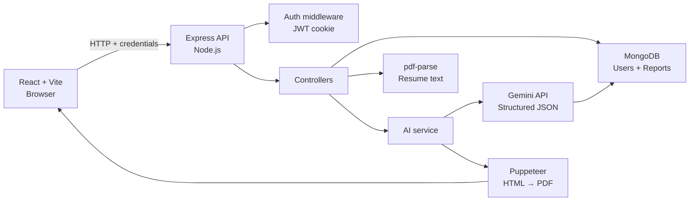
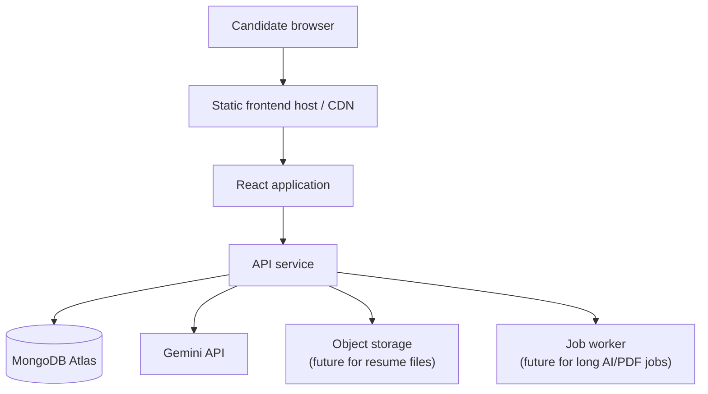
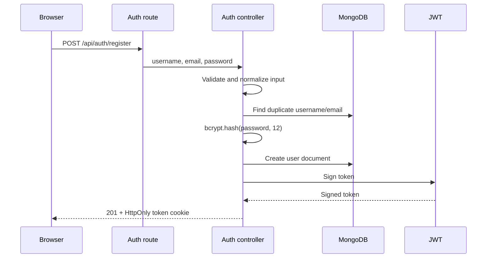
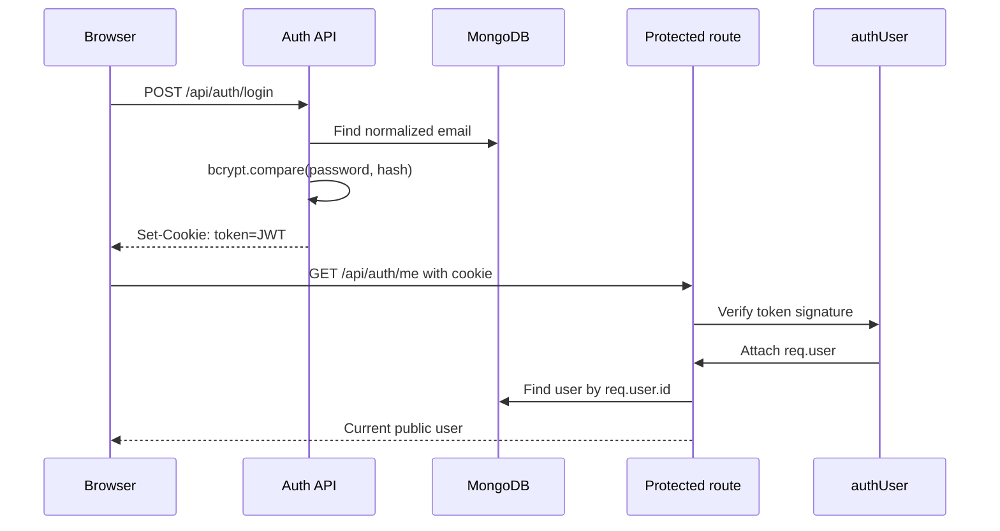
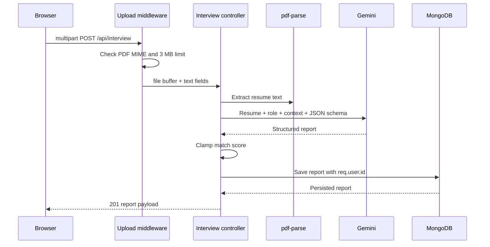
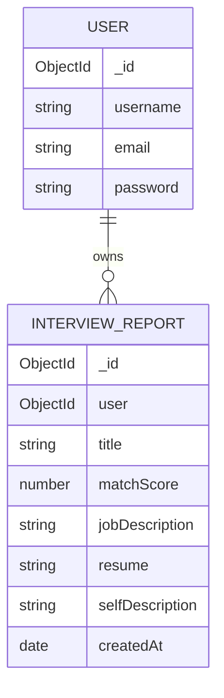
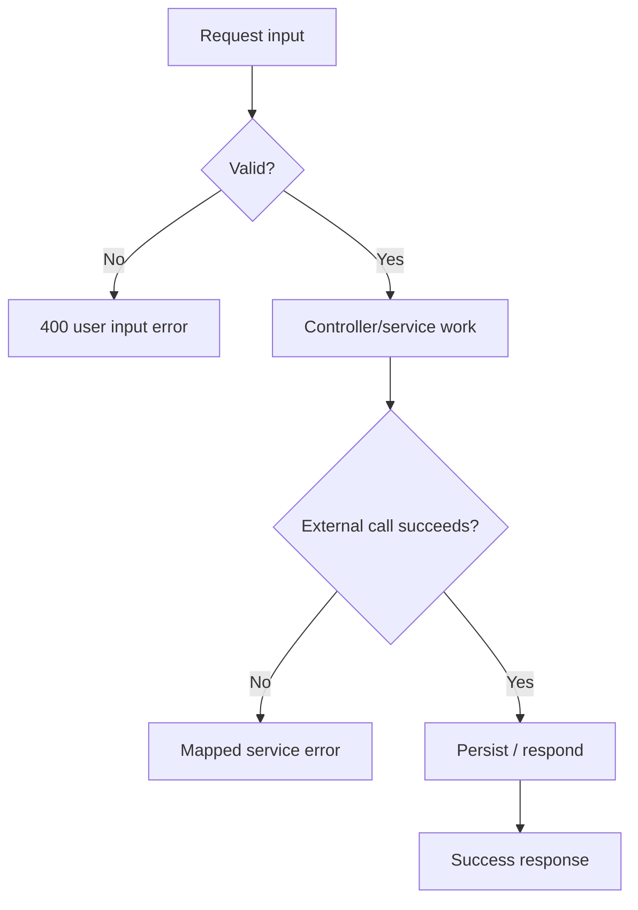
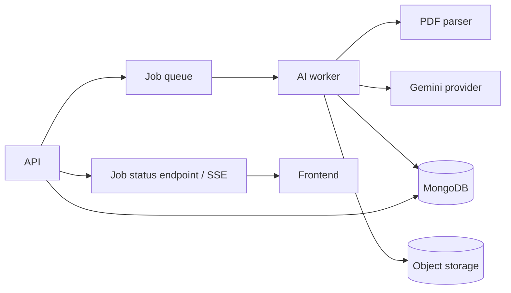

# HireLens

<p align="center">
  
  
  
  
  
</p>

<p align="center">
  <strong>Turn preparation into your unfair advantage.</strong><br />
  A full-stack, resume-aware AI workspace for role-specific interview preparation.
</p>

<p align="center">
  <a href="#quick-start">Quick start</a> ·
  <a href="#architecture-at-a-glance">Architecture</a> ·
  <a href="#api-reference">API reference</a> ·
  <a href="#interview-defense-guide">Interview guide</a>
</p>

---

## Table of contents

- [What is HireLens?](#what-is-hirelens)
- [Why this project is technically interesting](#why-this-project-is-technically-interesting)
- [Feature matrix and implementation truth](#feature-matrix-and-implementation-truth)
- [Technology stack](#technology-stack)
- [Repository structure](#repository-structure)
- [Architecture at a glance](#architecture-at-a-glance)
- [Core request lifecycles](#core-request-lifecycles)
- [Authentication and authorization](#authentication-and-authorization)
- [AI pipeline and prompt contract](#ai-pipeline-and-prompt-contract)
- [Resume processing and PDF generation](#resume-processing-and-pdf-generation)
- [Data model and persistence](#data-model-and-persistence)
- [API reference](#api-reference)
- [Environment configuration](#environment-configuration)
- [Quick start](#quick-start)
- [Frontend architecture](#frontend-architecture)
- [Design system](#design-system)
- [Error handling and observability](#error-handling-and-observability)
- [Security model](#security-model)
- [Performance and scalability](#performance-and-scalability)
- [Testing and verification](#testing-and-verification)
- [Troubleshooting](#troubleshooting)
- [System design interview guide](#system-design-interview-guide)
- [Technical interview questions](#technical-interview-questions)
- [Interview defense guide](#interview-defense-guide)
- [Roadmap](#roadmap)

---

## What is HireLens?

HireLens is a MERN-style career preparation platform that combines:

1. A candidate's resume context.
2. A target job description.
3. Optional candidate goals or self-description.
4. A structured Generative AI analysis.

The result is a persistent preparation report containing:

- A bounded role-match score.
- Technical questions with intent and model answers.
- Behavioral questions with intent and model answers.
- Skill gaps classified by severity.
- A day-wise preparation plan.

The product principle is simple:

> **The candidate and the role are the source of truth; the model is the reasoning layer.**

HireLens deliberately does not claim that an AI score guarantees an interview or bypasses an ATS. It is a preparation and feedback tool, not a hiring decision engine.

### Product workflow

```text
Create account
    ↓
Authenticate with an HTTP-only JWT cookie
    ↓
Upload a PDF resume and enter the target role
    ↓
Extract readable resume text in the backend
    ↓
Send resume + role + optional context to Gemini
    ↓
Parse a schema-constrained JSON report
    ↓
Persist the report against the authenticated user
    ↓
Render match signal, gaps, questions and preparation plan
    ↓
Generate an ATS-oriented PDF when requested
```

---

## Why this project is technically interesting

HireLens is small enough to understand end-to-end but rich enough to discuss real engineering trade-offs:

- **Authentication:** password hashing, JWT signing, cookies, CORS and protected routes.
- **Document ingestion:** multipart upload, MIME validation, memory limits and PDF parsing.
- **AI reliability:** structured output, prompt boundaries, model availability and provider errors.
- **Data modeling:** nested report data and user ownership constraints.
- **Document generation:** AI-generated HTML rendered to a PDF using a headless browser.
- **Frontend state:** loading, empty, error, success and navigation states.
- **System design:** synchronous MVP versus queues, object storage, caching and rate limiting.

This repository is also designed to be defendable in an interview: every major feature can be traced from browser event to controller, service, database write and response.

---

## Feature matrix and implementation truth

| Capability | Status | Current implementation |
|---|---:|---|
| Premium landing page | ✅ | React/Vite dark-first responsive interface |
| Registration | ✅ | Input checks, bcrypt hashing, JWT cookie |
| Login/logout | ✅ | Cookie-based session lifecycle |
| Current-user session | ✅ | Protected `/api/auth/me` |
| PDF resume upload | ✅ | Multer memory storage, PDF MIME check, 3 MB limit |
| PDF text extraction | ✅ | `pdf-parse` |
| Gemini report generation | ✅ | `@google/genai`, schema-shaped JSON response |
| Match score | ✅ | AI-generated and clamped to 0–100 |
| Skill-gap analysis | ✅ | Nested report data with low/medium/high severity |
| Technical questions | ✅ | Question, intention and answer |
| Behavioral questions | ✅ | Question, intention and answer |
| Preparation plan | ✅ | Day, focus and tasks |
| Report persistence | ✅ | MongoDB with authenticated user ownership |
| AI resume HTML | ✅ | Generated by Gemini for PDF rendering |
| Resume PDF export | ✅ | Puppeteer |
| DOCX upload | ❌ | PDF only in the current implementation |
| Dedicated deterministic ATS engine | ❌ | Current optimization is AI/prompt based |
| Live conversational interview | ❌ | Planned |
| Streaming AI output | ❌ | Current API waits for a complete report |
| Background job queue | ❌ | Synchronous MVP workflow |
| Automated integration test suite | ⚠️ | Syntax, build and smoke checks; expansion planned |

Honest status is a feature: documentation should describe what exists, not what a roadmap promises.

---

## Technology stack

### Frontend

| Technology | Why it is used |
|---|---|
| React 19 | Component-based UI and local state |
| Vite 6 | Fast development server and Node 20 compatibility |
| React Router | Client-side route composition |
| Axios | API client with `withCredentials: true` |
| CSS | Custom design tokens and responsive premium UI |

### Backend

| Technology | Why it is used |
|---|---|
| Node.js | JavaScript runtime |
| Express 5 | HTTP server, middleware and routing |
| Mongoose | MongoDB schemas, validation and queries |
| MongoDB | Persistent users and interview reports |
| bcryptjs | One-way password hashing |
| jsonwebtoken | Signed stateless session tokens |
| cookie-parser | Reading cookies from requests |
| cors | Controlled frontend/backend origin access |
| Multer | Multipart PDF upload handling |
| pdf-parse | PDF text extraction |
| `@google/genai` | Gemini API integration |
| Puppeteer | HTML-to-PDF rendering |
| dotenv | Local environment loading |

### Current AI model

The local configuration uses:

```env
GEMINI_MODEL=gemini-flash-lite-latest
```

The model is configurable through the environment rather than hard-coded into a deployment. Model availability and quotas can change by account, region and date; always verify the configured model with the provider before deployment.

---

## Repository structure

```text
HireLens/
├── server.js                         # Environment validation, DB startup, HTTP listener
├── package.json                      # Backend scripts and dependencies
├── package-lock.json
├── .env.example                      # Safe configuration template
├── .gitignore                        # Keeps .env and dependencies private
├── README.md
├── src/
│   ├── app.js                        # Express composition and middleware order
│   ├── config/
│   │   └── database.js               # Mongoose connection
│   ├── controllers/
│   │   ├── auth.controllers.js       # Register, login, logout, current user
│   │   └── interview.controllers.js  # Upload, AI report, retrieval, PDF
│   ├── middlewares/
│   │   ├── auth.middleware.js        # JWT cookie verification
│   │   └── file.middleware.js        # PDF upload policy
│   ├── models/
│   │   ├── user.model.js
│   │   └── interviewReport.model.js
│   ├── routes/
│   │   ├── auth.routes.js
│   │   └── interview.routes.js
│   └── services/
│       └── ai.service.js             # Gemini and Puppeteer integration
└── frontend/
    ├── index.html
    ├── package.json
    └── src/
        ├── main.jsx                  # Routes, pages, API integration
        └── styles.css                # Design system and responsive UI
```

### Backend layering

```text
Route
  → Middleware
    → Controller
      → Model / Service
        → External system or database
```

Controllers own HTTP concerns. Services own external integrations. Models own persistence shape. This avoids placing Gemini calls, database queries and response formatting in one route file.

---

## Architecture at a glance

### Logical architecture



### Deployment topology



The current local MVP does not require the future storage or worker nodes. They are the natural production evolution for large files, long-running inference and retryable jobs.

### Trust boundaries

```text
Untrusted browser input
        |
        | validation, origin policy, upload limits
        v
Express API boundary
        |
        | authenticated user identity
        v
Database / AI provider / PDF renderer
```

The browser is never trusted to provide a user id. Ownership is derived from the verified JWT and applied to every report query.

---

## Core request lifecycles

### Registration



### Login and protected request



### Resume-to-report flow



### PDF export flow

```text
Authenticated request
  → Load report using both report id and req.user.id
  → Send report context to Gemini
  → Receive safe HTML string
  → Launch Puppeteer
  → Set page content
  → Render A4 PDF
  → Close browser in finally
  → Stream application/pdf response
```

---

## Authentication and authorization

### Authentication

Passwords are never stored directly. Registration performs:

```js
const hashedPassword = await bcrypt.hash(password, 12);
```

Login performs:

```js
await bcrypt.compare(plainTextPassword, storedHash);
```

After successful login, the server signs a JWT containing a minimal identity payload:

```text
{
  id: user._id,
  username: user.username
}
```

The JWT is placed in a cookie named `token`:

| Cookie attribute | Development behavior |
|---|---|
| `httpOnly` | `true` |
| `sameSite` | `lax` |
| `secure` | `false` locally, `true` in production |
| `maxAge` | 24 hours |

### Authorization

The `authUser` middleware:

1. Reads `req.cookies.token`.
2. Rejects a missing cookie with `401`.
3. Verifies the token using `JWT_SECRET`.
4. Attaches the decoded user identity to `req.user`.
5. Calls `next()` only when verification succeeds.

Every report lookup uses authenticated ownership:

```js
{
  _id: req.params.interviewId,
  user: req.user.id
}
```

This prevents an authenticated user from reading another user's report by changing an id in the URL.

### Authentication versus authorization

- **Authentication:** Who is this user? JWT verification answers this.
- **Authorization:** Is this user allowed to access this resource? The `user` filter answers this.

Having a valid JWT alone is not enough; the database query must still scope the resource to the authenticated user.

---

## AI pipeline and prompt contract

### Inputs

The report request combines:

- Extracted PDF resume text, when a file is provided.
- `selfDescription`, optional candidate context.
- `jobDescription`, required target-role context.

### Prompt contract

The service instructs Gemini to:

- Act as a senior technical interview mentor.
- Compare candidate context to the target role.
- Return only valid JSON.
- Follow the supplied response schema.
- Avoid inventing candidate experience.
- Identify gaps explicitly.

### Response shape

```json
{
  "title": "Software Development Engineer preparation",
  "matchScore": 78,
  "technicalQuestions": [
    {
      "question": "Explain how you would design...",
      "intention": "Tests system design reasoning",
      "answer": "A strong answer should..."
    }
  ],
  "behavioralQuestions": [
    {
      "question": "Tell me about a difficult trade-off...",
      "intention": "Tests ownership and communication",
      "answer": "Use a specific STAR example..."
    }
  ],
  "skillGaps": [
    {
      "skill": "Distributed systems",
      "severity": "medium"
    }
  ],
  "preparationPlan": [
    {
      "day": 1,
      "focus": "Role fundamentals",
      "tasks": ["Review REST design", "Practice one system-design prompt"]
    }
  ]
}
```

### Why structured output matters

Without a schema, the model may return headings, Markdown, prose or missing fields. Structured output makes the contract explicit and reduces rendering ambiguity. The backend still parses the returned text and treats parse failure as an error; schema constraints are not a substitute for validation.

### AI reliability boundaries

The AI provider can:

- Rate-limit or temporarily return `503`.
- Deprecate a model.
- Return malformed content.
- Produce a low-quality or incomplete analysis.

The application therefore:

- Makes the model configurable.
- Clamps `matchScore` to `0..100`.
- Converts invalid JSON into a `502`-style service error.
- Does not silently fabricate a successful report.
- Keeps API keys server-side.

---

## Resume processing and PDF generation

### Upload policy

The current upload middleware accepts:

- One file field: `resume`.
- PDF MIME type only.
- Maximum size: 3 MB.
- In-memory storage.

Memory storage is appropriate for the current small-file MVP because the PDF is immediately parsed and is not stored as a binary file. It is not ideal for large files or high concurrency.

### Production evolution

For production-scale uploads:

1. Validate extension, MIME and file signature.
2. Upload directly to object storage using a signed URL.
3. Store metadata and object key, not raw files in MongoDB.
4. Queue extraction and AI analysis.
5. Delete temporary files after processing.
6. Encrypt objects at rest and restrict access by user ownership.

### Puppeteer security boundary

AI-generated HTML is rendered by a headless browser. The service should keep generated HTML constrained:

- No scripts.
- No remote resources unless explicitly allowed.
- No user-controlled navigation.
- Short browser lifetime.
- Always close the browser in `finally`.

The current implementation generates an ATS-oriented HTML resume and renders it to A4 PDF. It is not yet a full deterministic resume template engine.

---

## Data model and persistence

### User document

The user model stores the account identity and password hash:

```text
User
├── username
├── email
└── password (bcrypt hash)
```

The password should never be returned in public responses. The controllers project only:

```text
id, username, email
```

### InterviewReport document

```text
InterviewReport
├── user                 → users._id
├── title
├── jobDescription
├── resume
├── selfDescription
├── matchScore           0..100
├── technicalQuestions[]
│   ├── question
│   ├── intention
│   └── answer
├── behavioralQuestions[]
│   ├── question
│   ├── intention
│   └── answer
├── skillGaps[]
│   ├── skill
│   └── severity         low | medium | high
├── preparationPlan[]
│   ├── day
│   ├── focus
│   └── tasks[]
├── createdAt
└── updatedAt
```

The `user` field is indexed because the dominant access pattern is “list this user's reports” and “load this user's report by id.”

### Relationship



### Data retention considerations

Resume text and job descriptions can contain personal or confidential information. A production version should define:

- Retention period.
- User deletion behavior.
- Export and deletion endpoints.
- Encryption and access logging.
- Whether provider prompts are retained by the AI vendor.

---

## API reference

Base URL:

```text
http://localhost:3000
```

All JSON responses use a `message` field for user-readable errors where applicable.

### Health/root endpoint

```http
GET /
```

Response:

```text
HireLens API is running
```

### Register

```http
POST /api/auth/register
Content-Type: application/json
```

Body:

```json
{
  "username": "Sonam Narula",
  "email": "sonam@example.com",
  "password": "Test12345"
}
```

Success: `201 Created`, sets `token` cookie.

### Login

```http
POST /api/auth/login
Content-Type: application/json
```

Body:

```json
{
  "email": "sonam@example.com",
  "password": "Test12345"
}
```

Success: `200 OK`, sets `token` cookie.

### Logout

```http
POST /api/auth/logout
```

Clears the `token` cookie.

### Current user

```http
GET /api/auth/me
Cookie: token=<jwt>
```

Success: `200 OK`.

### Generate interview report

```http
POST /api/interview
Content-Type: multipart/form-data
Cookie: token=<jwt>
```

Fields:

| Field | Required | Description |
|---|---:|---|
| `resume` | One of resume/context | PDF file, max 3 MB |
| `jobDescription` | Yes | Target role requirements |
| `selfDescription` | One of resume/context | Optional candidate context |

At least one of `resume` or non-empty `selfDescription` is required.

Success: `201 Created`.

### List reports

```http
GET /api/interview
Cookie: token=<jwt>
```

Returns the current user's reports without the large resume and job-description fields.

### Get one report

```http
GET /api/interview/report/:interviewId
Cookie: token=<jwt>
```

The user ownership filter is applied server-side.

### Generate resume PDF

```http
POST /api/interview/resume/pdf/:interviewReportId
Cookie: token=<jwt>
```

Success:

```text
Content-Type: application/pdf
Content-Disposition: attachment
```

### Status code semantics

| Status | Meaning |
|---:|---|
| `200` | Successful read/action |
| `201` | Resource created |
| `400` | Invalid or incomplete input |
| `401` | Missing/invalid authentication |
| `404` | Resource does not exist for this user |
| `409` | Duplicate account conflict |
| `502` | Upstream AI returned unusable output |
| `503` | Required service configuration or provider unavailable |
| `500` | Unexpected server failure |

---

## Environment configuration

Create a root `.env` file. Never commit it.

```env
MONGO_URI=mongodb+srv://<user>:<password>@<cluster>/<database>
JWT_SECRET=replace-with-a-long-random-secret
GOOGLE_GENAI_API_KEY=replace-with-your-private-key
GEMINI_MODEL=gemini-flash-lite-latest
FRONTEND_URL=http://localhost:5173
PORT=3000
```

### Variable reference

| Variable | Required | Purpose |
|---|---:|---|
| `MONGO_URI` | Yes | MongoDB connection string |
| `JWT_SECRET` | Yes | JWT signing and verification |
| `GOOGLE_GENAI_API_KEY` | Yes for AI | Server-side Gemini credential |
| `GEMINI_MODEL` | No | Configurable Gemini model |
| `FRONTEND_URL` | No | Primary allowed frontend origin |
| `PORT` | No | Defaults to `3000` |

The server validates required configuration before connecting and listening. Missing credentials should fail at startup rather than during a user request.

### Secret safety

Do not:

- Paste API keys into chat, screenshots or issues.
- Put secrets in `frontend/.env` if the browser can bundle them.
- Commit `.env`.
- Log full tokens or provider keys.
- Use `git add -f .env`.

If a key is exposed, revoke it and generate a replacement.

---

## Quick start

### Prerequisites

- Node.js 20 or newer.
- npm.
- MongoDB Atlas or local MongoDB.
- Gemini API key for AI analysis.

### Backend

```bash
cd /Users/sonamnarula/Desktop/HireLens
npm install
cp .env.example .env
# Edit .env with your own values
npm run dev
```

Expected:

```text
MongoDB Connected: <host>
Server is running on port 3000
```

### Frontend

Open a second terminal:

```bash
cd /Users/sonamnarula/Desktop/HireLens/frontend
npm install
npm run dev
```

Open:

```text
http://localhost:5173
```

The frontend also works at `http://127.0.0.1:5173`; the backend allows both local development origins.

### Smoke test

```bash
curl http://localhost:3000/
```

Register:

```bash
curl -i -c /tmp/hirelens-cookies.txt \
  -X POST http://localhost:3000/api/auth/register \
  -H "Content-Type: application/json" \
  -d '{"username":"demo","email":"demo@example.com","password":"Test12345"}'
```

Check session:

```bash
curl -i -b /tmp/hirelens-cookies.txt \
  http://localhost:3000/api/auth/me
```

### Scripts

Backend:

```bash
npm run dev
npm test
```

Frontend:

```bash
npm run dev
npm run build
npm run preview
```

---

## Frontend architecture

The frontend is intentionally compact and currently composed from `frontend/src/main.jsx` and `frontend/src/styles.css`.

### Route map

| Route | Surface | Access |
|---|---|---|
| `/` | Landing page | Public |
| `/login` | Login | Public |
| `/register` | Registration | Public |
| `/dashboard` | Workspace overview | Protected |
| `/resume` | Resume lab and AI analysis | Protected |
| `/match` | Match-score workspace | Protected |
| `/interview` | Interview preparation entry | Protected |
| `/interview/:id` | Generated report | Protected |
| `/settings` | Profile/settings surface | Protected |

### Auth guard behavior

On protected routes, `AuthGuard` calls `/api/auth/me`. If the request fails, the user is redirected to `/login`. Axios is configured with:

```js
withCredentials: true
```

This is necessary because the session is carried in a cookie rather than a browser-managed authorization header.

### UI state model

Every important operation should have:

```text
idle → loading → success
             ↘ error
```

The resume lab exposes:

- Missing-input validation.
- Selected-file state.
- Disabled/loading action button.
- API error message.
- Navigation to the generated report.

### Current frontend improvement opportunities

- Add a global toast system.
- Add report list state to the dashboard.
- Add retry/backoff messaging for temporary AI outages.
- Add an AbortController timeout for long AI requests.
- Split the large page module into feature folders.
- Add accessible labels and automated accessibility checks.

---

## Design system

HireLens uses a dark-first visual system intended to feel closer to a focused professional workspace than a tutorial dashboard.

### Design principles

- Deep charcoal surfaces instead of pure black.
- Lime accent reserved for primary action and progress signal.
- Quiet borders and restrained shadows.
- Generous whitespace and clear hierarchy.
- Real iconography rather than emoji UI controls.
- Responsive navigation and compact mobile behavior.
- Empty states that explain the next action.

### Component vocabulary

```text
Button
Input / Textarea
Card / Panel
Status pill
Empty state
Upload zone
Sidebar navigation
Score visualization
Question block
Preparation-plan item
```

The next design-system step is extracting these primitives into reusable React components with typed variants and centralized tokens.

---

## Error handling and observability

### Error flow



The backend has a final Express error middleware. Known service failures should retain meaningful status codes; unexpected errors should not leak stack traces to the browser.

### Current observability

- Startup logs MongoDB connection host and server port.
- Request failures are logged server-side.
- Browser receives a safe message.
- Secrets are not intended to be logged.

### Production observability plan

- Correlation/request id.
- Structured JSON logs.
- Request duration and status metrics.
- AI latency, token usage and provider status metrics.
- Error tracking with redacted payloads.
- Alerts for repeated provider failures.

---

## Security model

### Implemented protections

- bcrypt password hashing.
- HTTP-only authentication cookie.
- JWT signature verification.
- Protected routes.
- User-scoped report queries.
- CORS allowlist for local frontend origins.
- PDF-only upload policy.
- 3 MB upload limit.
- Generic unexpected-error responses.
- Environment secrets outside source control.

### Threat model

| Threat | Mitigation |
|---|---|
| Password database leak | bcrypt hash, never plaintext |
| Token access from ordinary JS | HTTP-only cookie |
| Cross-origin credential abuse | CORS allowlist |
| Report ID enumeration | User ownership in every query |
| Oversized upload | Multer file-size limit |
| Unsupported upload type | PDF MIME policy |
| Prompt data leakage | Keep provider key server-side; document retention policy |
| HTML/Puppeteer abuse | Constrain generated HTML; no scripts/resources |
| Brute-force login | Rate limiting still required |
| CSRF | SameSite helps locally; add CSRF strategy for cross-site production |

### Production security backlog

- Rate limit login and AI endpoints.
- Add helmet/security headers.
- Add request-body size limits.
- Validate PDF magic bytes, not only MIME.
- Encrypt sensitive persisted text where required.
- Add account deletion and data export.
- Add refresh-token rotation or short-lived access-token strategy.
- Add CSRF protection if cookie behavior requires cross-site requests.
- Redact resume text from logs and traces.

---

## Performance and scalability

### Current MVP characteristics

The report endpoint is synchronous:

```text
upload → parse → Gemini request → MongoDB write → response
```

This is easy to understand and works well for small demos, but the request remains open while AI and parsing complete.

### Scaling bottlenecks

1. PDF parsing consumes server memory.
2. Gemini latency keeps an HTTP request open.
3. Puppeteer launches a browser process.
4. Large resume text increases prompt size and cost.
5. Concurrent requests can exhaust provider quota.

### Production architecture



The API would return `202 Accepted` with a job id. The frontend would poll or subscribe to status updates. Workers could retry transient provider failures with exponential backoff and a dead-letter queue.

### Cost and latency controls

- Truncate or summarize very large resumes.
- Cache identical normalized inputs.
- Use a cheaper flash model for first-pass analysis.
- Limit report question counts.
- Add per-user quotas.
- Queue PDF generation.
- Avoid sending binary PDFs directly to the AI provider when text extraction is enough.

---

## Testing and verification

### Current checks

Backend syntax:

```bash
npm test
```

Frontend production build:

```bash
cd frontend
npm run build
```

Manual smoke path:

```text
Register → Login → /api/auth/me → Upload PDF → Analyze → Read report
```

### Recommended automated test pyramid

#### Unit tests

- Password validation.
- Email normalization.
- Score clamping.
- Report-shape validation.
- Upload policy.
- Prompt construction.

#### Integration tests

- Register and duplicate conflict.
- Login invalid credentials.
- Cookie-protected `/api/auth/me`.
- Unauthenticated report rejection.
- Cross-user report access rejection.
- Report persistence.

#### Contract tests

- Gemini response parsing.
- PDF extraction output.
- PDF response headers.

#### End-to-end tests

- Browser registration and login.
- Resume upload.
- Loading and error states.
- Report navigation.

### Test cases to defend in an interview

| Case | Expected |
|---|---|
| Password shorter than 8 chars | `400` |
| Existing email/username | `409` |
| Wrong login password | `401` |
| Missing token | `401` |
| Invalid token | `401` |
| Missing job description | `400` |
| No resume and no self-description | `400` |
| Non-PDF upload | Rejected |
| File over 3 MB | Rejected |
| AI provider unavailable | Service error, no fake report |
| Report owned by another user | `404` |

---

## Troubleshooting

### `nodemon: command not found`

From the project root:

```bash
npm install
npm run dev
```

### `app.listen is not a function`

Check that the Express app is exported with:

```js
module.exports = app;
```

not `module.export`.

### `JWT_SECRET is not configured`

Add `JWT_SECRET` to the root `.env`, then fully restart the backend. Do not put it in the frontend.

### `GOOGLE_GENAI_API_KEY is not configured`

Add the key to the root `.env`, never to browser code, then restart Node. Verify without printing the secret:

```bash
grep -q '^GOOGLE_GENAI_API_KEY=.' .env \
  && echo "Gemini key configured" \
  || echo "Gemini key missing"
```

### Gemini model not found or unavailable

Check the model configured in `.env`:

```bash
grep '^GEMINI_MODEL=' .env
```

Model names and availability can change. List models using the provider SDK or select an available model in Google AI Studio. Restart the backend after changing `.env`.

### `Internal server error` during analysis

The browser message is intentionally generic. Read the backend terminal's latest error. Common causes:

- Provider model unavailable.
- Provider quota/rate limit.
- Invalid API key.
- Malformed model JSON.
- MongoDB write failure.
- PDF parser failure.

Do not share the API key when sharing logs.

### `Unable to connect`

Check both processes:

```bash
lsof -nP -iTCP:3000 -sTCP:LISTEN
curl http://localhost:3000/
```

Use the same host consistently:

```text
Frontend: http://localhost:5173
Backend:  http://localhost:3000
```

The current development CORS policy supports both `localhost` and `127.0.0.1`.

### Multiple backend processes

Multiple nodemon instances can make debugging confusing. Stop duplicate HireLens terminals with `Control + C`, then start one backend:

```bash
cd /Users/sonamnarula/Desktop/HireLens
npm run dev
```

Never kill unrelated applications by process name.

### Puppeteer fails

Chromium may need deployment-specific dependencies. Keep Puppeteer browser lifecycle inside `try/finally`, and use a container/runtime that supports headless Chromium.

---

## System design interview guide

### 1. Design a production version of HireLens

**Start with requirements:**

- Candidate registers and authenticates.
- Candidate uploads a resume.
- Candidate adds a target job.
- System produces a structured report.
- Candidate can revisit reports and export a PDF.

**Non-functional requirements:**

- Private user data.
- Predictable latency for normal requests.
- Retryable AI failures.
- Quotas and abuse protection.
- Horizontal scalability.
- Observability and auditability.

**First architecture:**

```text
React → API gateway/load balancer → stateless API
                                      ├── MongoDB
                                      ├── object storage
                                      ├── queue
                                      └── AI workers
```

**Why asynchronous processing?**

AI calls and PDF rendering can take seconds or fail transiently. A queue prevents the API request from being held open and lets workers retry safely.

### 2. How would you scale from 100 to 1 million users?

1. Keep API instances stateless.
2. Store files in object storage, not process memory.
3. Add a queue for parsing and AI jobs.
4. Add MongoDB indexes on `user`, `createdAt` and job status.
5. Add quotas per user and per IP.
6. Cache normalized repeated analysis only where privacy policy permits.
7. Separate report reads from AI writes.
8. Add worker autoscaling based on queue depth.
9. Add CDN delivery for frontend assets.
10. Use provider fallbacks only with an explicit data policy.

### 3. How do you prevent unauthorized report access?

Never trust a report id alone. After verifying the JWT:

```js
findOne({
  _id: requestedReportId,
  user: req.user.id
})
```

If no matching document exists, return `404`. This avoids confirming whether another user's report id exists.

### 4. How would you handle AI outages?

- Return a clear retryable error.
- Classify provider errors into invalid request, quota, unavailable and timeout.
- Retry only transient categories.
- Use exponential backoff with jitter in workers.
- Persist job status (`queued`, `processing`, `completed`, `failed`).
- Never create a fake success report.
- Show the user whether retrying is safe.

### 5. How would you improve AI quality?

- Use a versioned prompt template.
- Use structured output and schema validation.
- Normalize resume text before prompting.
- Keep candidate evidence separate from inferred recommendations.
- Ask for citations to resume sections in a future schema.
- Evaluate on a fixed benchmark of anonymized resumes and roles.
- Track hallucination, completeness and consistency metrics.

### 6. How would you design a deterministic ATS score?

Do not rely only on an LLM. Build a hybrid:

```text
Parse resume
  → normalize terms and synonyms
  → extract job skills and constraints
  → compute keyword/semantic coverage
  → check section/readability rules
  → combine weighted signals
  → ask LLM for explanation, not the numeric truth
```

This makes the score reproducible and keeps the model focused on explanations and suggestions.

### 7. What would you cache?

Potential cache keys:

```text
hash(normalized_resume + normalized_job + prompt_version + model)
```

Cache only if:

- The user has permission to reuse the result.
- Sensitive data handling is documented.
- The result is versioned.
- Invalidations happen when prompts/models change.

### 8. How do you protect the AI endpoint?

- Authentication.
- Per-user request quotas.
- IP rate limiting.
- Maximum file and text sizes.
- Request timeout.
- Queue concurrency limits.
- Provider budget alerts.
- Redacted logs.

---

## Technical interview questions

Use these questions to practice defending the actual codebase.

### JavaScript and Node.js

1. Why does `require("dotenv").config()` need to run before importing modules that read environment variables?
2. What is the difference between synchronous and asynchronous Node.js work in the report request?
3. Why is `finally` important around Puppeteer cleanup?
4. What happens when an async Express controller throws?
5. Why should a CPU-heavy PDF operation move to a worker at scale?

### Express

1. What is the middleware order in `src/app.js`?
2. Why must `express.json()` run before JSON route handlers?
3. How does CORS differ from authentication?
4. Why is the final error middleware placed after routes?
5. How would you add request ids?

### MongoDB and Mongoose

1. Why is `InterviewReport.user` indexed?
2. Why embed questions inside a report instead of creating separate collections?
3. What are the trade-offs of storing extracted resume text in MongoDB?
4. How would you paginate a user's reports?
5. How would you implement account deletion?

### Authentication

1. Why bcrypt instead of encryption?
2. Why is an HTTP-only cookie safer than localStorage for a token?
3. What happens when the JWT expires?
4. What is the difference between token verification and resource authorization?
5. What changes are required for production cookie settings?

### AI and LLMs

1. Why is structured output necessary?
2. What happens if the model returns invalid JSON?
3. How do temperature and prompt constraints affect output?
4. How do you evaluate an AI-generated match score?
5. What is prompt injection in a resume or job description?

### Files and PDF

1. Why is Multer memory storage acceptable for a small MVP?
2. Why is MIME validation alone insufficient?
3. What are the risks of rendering generated HTML?
4. How would you support DOCX?
5. How would you prevent a 100 MB upload from exhausting memory?

---

## Interview defense guide

### “Explain HireLens in 60 seconds”

> HireLens is a full-stack AI career-preparation platform. A user registers with bcrypt-protected credentials and receives a JWT in an HTTP-only cookie. After authentication, they upload a PDF resume and provide a target job description. The backend extracts resume text, sends the candidate context to Gemini using a structured JSON contract, validates and persists the resulting match score, skill gaps, technical and behavioral questions, and preparation plan in MongoDB. The React frontend renders that report, and the backend can generate an ATS-oriented resume PDF through AI-generated HTML and Puppeteer. The current version is a synchronous MVP; I would move AI and PDF work to a queue with object storage for production scale.

### “What was the hardest engineering problem?”

> The hardest part was making an external AI dependency behave like a reliable backend service. Model names and quotas can change, provider calls can return transient errors, and free-form text is difficult to render safely. I addressed that with environment-configurable models, a structured response schema, explicit parsing errors, bounded scores, server-side secrets and no fake success fallback. The next step is retries and asynchronous jobs.

### “What would you improve next?”

> I would add a deterministic ATS signal layer, background jobs, object storage, rate limiting, integration tests, report pagination, deletion/export controls and an evaluation benchmark for AI quality. Those improvements target correctness, privacy, reliability and scale rather than only adding UI.

### “What did you intentionally not build?”

> DOCX parsing, live voice interviews, streaming output and a deterministic ATS engine are not complete in the current code. The current product supports PDF ingestion and a prompt-based AI analysis workflow. Calling those features complete would be misleading.

### Strong trade-off vocabulary

Use these phrases naturally:

- “For the MVP, I chose simplicity and traceability.”
- “That is synchronous today, but it is a clear queue boundary.”
- “The model is an explanation layer, not the sole source of truth.”
- “Authorization is enforced in the query, not only in the route.”
- “I prefer an explicit failure to a success-shaped fallback.”
- “The current limit is known and documented.”

---

## Roadmap

### Reliability

- [ ] Add request timeout and cancellation.
- [ ] Add provider error classification and retry policy.
- [ ] Add structured logging and correlation ids.
- [ ] Add automated integration tests.

### Product

- [ ] Persist and display recent report history on the dashboard.
- [ ] Add report comparison over time.
- [ ] Add targeted follow-up questions.
- [ ] Add interview answer scoring with evidence.

### Resume intelligence

- [ ] Add DOCX support.
- [ ] Add deterministic ATS checks.
- [ ] Add section and formatting diagnostics.
- [ ] Add explainable skill extraction with source snippets.

### Scale and privacy

- [ ] Move files to object storage.
- [ ] Add queue-backed analysis jobs.
- [ ] Add quotas and rate limiting.
- [ ] Add account deletion and data export.
- [ ] Add retention controls and provider data policy.

### Developer experience

- [ ] Split frontend into feature modules.
- [ ] Add typed API contracts.
- [ ] Add OpenAPI documentation.
- [ ] Add CI for syntax, build, tests and dependency audit.

---

## Engineering principles

1. **Do not invent implementation status.** Document what is working today.
2. **Keep secrets server-side.** Never bundle provider credentials into React.
3. **Validate at boundaries.** Browser validation improves UX; server validation protects the system.
4. **Authorize every resource.** A valid session does not imply access to every report.
5. **Prefer explicit failure.** Do not return a fake AI report when the provider fails.
6. **Design the migration path.** A synchronous MVP can have a clean queue boundary.
7. **Make trade-offs explainable.** The best interview project is one whose decisions you can defend.

---

## License

This project is currently intended as a portfolio and learning project. Add a formal license before distributing it as a reusable open-source package.

